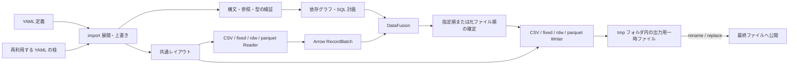

# dxtran 設計仕様書

状態: 初期設計案 / 仕様版: 0.19 / 作成日: 2026-10-22 / 更新日: 2026-10-28

## 1. 目的と設計上の前提

dxtran（コマンド名: `dxt`）は、CSV、固定長、RDW 付き可変長、Parquet ファイルを読み込み、Apache DataFusion の SQL で編集・変換し、CSV、固定長、RDW 付き可変長または Parquet ファイルへ出力するバッチ処理ツールとする。複数の入力の結合、抽出、項目追加、型変換、集計、並べ替え、複数形式への出力を、1つの YAML ファイルで定義する。

項目は YAML に直接定義する。定義の任意の枝は `import` で再利用し、利用側で上書きできる。`process` は WITH 句のように参照する中間データセットを定義し、最終的な編集・集計 SQL は `output` に直接指定できる。順序を明示しなければ、元ファイルのレコード順を維持する。

初期版は Rust 製の単一プロセス CLI とし、ローカルファイルを対象とする。既存リポジトリの Rust 設定に合わせた選択であり、GUI やサーバーは対象としない。本書は設計であり、記載するコマンドや設定はこれから実装する。

依頼文の `ouput` は `output` の誤記と解釈する。正式な最上位キーは `input`、`process`、`output` の3つだけとし、互換エイリアスは設けない。

## 2. 対応範囲

| 分類 | 初期版の対応 |
| --- | --- |
| 入力 | CSV、固定長（`fixed`）、RDW 付き可変長（`rdw`）、Parquet（`parquet`） |
| 編集 | DataFusion SQL による選択、フィルタ、式、結合、集計、ウィンドウ関数 |
| 出力 | CSV、固定長、RDW 付き可変長、Parquet。Parquet は SQL 結果スキーマ、他の形式は YAML の項目定義を使用 |
| 定義の再利用 | 任意の枝への `import` と利用側の値による上書き |
| 行順 | 元ファイル順を既定とし、SQL の ORDER BY で変更可能 |
| 文字コード | encoding_rs と jtc-utils が認識する全ラベル・別名。明示指定し、自動判定しない |
| レコードの境界 | 固定長は改行なし / LF / CRLF、可変長は RDW。幅・位置はすべてバイト単位 |
| 項目の格納形式 | `type` に文字列・10進数・整数・IEEE / IBM HFP・ゾーン / パック10進数・真偽値・日付時刻・バイト列を指定 |
| ビット項目 | n バイトの `bits` を読み、各ビットを名前付き Boolean 列として公開 |
| 文字の幅埋め | `pad_char` で Unicode 1文字を指定。既定は U+0020、U+3000 等も指定可能 |
| CSV の項目別クォート | `output.fields` の各項目で `quote_style` を指定。`csv.quote_style` は共通の既定値。NULL と空文字の区別を維持 |
| NULL 出力 | fixed は型別の既定値で補完する。文字・日時等は空白、数値は0、binary はゼロバイト、bits の NULL 子は false。rdw は明示した NULL 表現を使用可能 |
| 実行 | 設定検証、SQL 計画の表示、ストリーム実行、実行結果の記録 |

BDW、spanned record、gzip / zstd / Parquet 内部の圧縮以外の圧縮ファイル、リモートストレージ、任意コードの実行、分散実行は後続の拡張対象とする。copybook の取り込み・解析は対象に含めない。

## 3. 全体構成



外部ファイル形式と SQL 処理を Arrow のスキーマと `RecordBatch` で分離する。import 展開後の YAML 項目定義を共通レイアウトに変換し、Reader と Writer で共有する。入力行に付けた非公開のデータセット番号・元レコード番号と、演算ごとの順序情報を SQL の計画を通じて引き継ぐ。

DataFusion のカスタム入力は `TableProvider`、`ExecutionPlan`、バッチストリームの層に分けられる。この拡張点を使って fixed / rdw 入力を登録する。CSV も文字コード、NULL、エラー位置の扱いを統一するため同じ入力インターフェースに接続する。計画作成時にはデータ本体を読み込まず、ストリームが要求された時点で読み込む。[DataFusion: Custom Table Provider](https://datafusion.apache.org/library-user-guide/custom-table-providers.html)

## 4. YAML の共通規則

```yaml
input: []
process: []
output: []
```

- import 展開後の最上位で使えるキーは `input`、`process`、`output` とし、指定する値はすべて配列。`input` と `output` は必須でそれぞれ1件以上、`process` は省略可能で0件以上とする。`process` の省略は `process: []` と同じ扱いとし、明示した NULL や配列以外の値はエラーとする。
- 各 output は `sql` を必須とする。`process` を省略した場合や `process: []` でも、`output.sql` に編集・結合・集計を書ける。単純な形式変換も `SELECT * FROM sales` 等の SQL で入力を指定する。
- 項目定義は形式共通で input / output 直下の `fields` に置く。CSV の共通設定は `csv`、fixed のレコード設定は `fixed`、RDW の共通設定は `rdw` にまとめる。
- 各定義に `id` を付ける。`input` と `process` の ID は同じ SQL テーブル名の名前空間を共有し、重複を禁止する。出力 ID は出力内で一意とする。
- ID と公開列名は `[a-z][a-z0-9_]*` とし、SQL では予約語に当たる場合に二重引用符で囲む。
- `dxt$` 始まりの名前は内部処理専用とする。ユーザー SQL の識別子・別名（CTE やテーブル別名、列の別名を含む）には、引用符と大文字・小文字にかかわらず使用できない。公開列名の規則を緩和するものではない。
- 重複した YAML キー、複数 YAML ドキュメント、独自タグ、アンカー・エイリアスは設定エラーとする。値は YAML 1.2 に従って型を解釈する。`import` を展開してから、結果の不明なキーと型を検証する。
- YAML は UTF-8 とし、YAML の相対パスはその値を書いた YAML ファイルの所在ディレクトリから解決する。import 元から引き継いだ値と利用側で上書きした値は、それぞれの記述元を基準にする。CLI で指定した入出力パスは起動時のカレントディレクトリを基準にする。
- input / output の `path` は YAML では省略できる。CLI の `--input.<id>.path` / `--output.<id>.path` を指定した場合は、import 展開後の該当 ID の値より優先する。各パスは YAML または CLI のいずれかで指定する必要がある。
- 初期版は1入力定義につき1ファイル、1出力定義につき1ファイル。glob、ディレクトリ入力、標準入出力は扱わない。
- 環境変数やテンプレートの展開は行わない。実行時のメモリ量等は CLI オプションで指定し、最上位キーを増やさない。
- サポートする設定文法は dxtran のバージョンと対応させる。破壊的変更は互換性変更として明示する。

## 5. 設定の全体例

売上の固定長項目を直接定義し、有効な売上を中間データセットにする。出力ごとの SQL で顧客 CSV と結合し、明細 CSV と地域別集計の固定長ファイルを出力する。

```yaml
input:
  - id: sales
    format: fixed
    path: ./data/sales.dat
    encoding: cp932
    fixed:
      record_separator: crlf
      record_length: 16
    fields:
      - { name: customer_id, length: 6, type: string }
      - { name: amount, length: 9, type: uzoned, zone: ascii, precision: 9, scale: 2 }
      - { name: status, length: 1, type: string }

  - id: customers
    format: csv
    path: ./data/customers.csv
    encoding: utf-8
    csv:
      header: true
      delimiter: ","
      quote: '"'
    fields:
      - { name: customer_id, type: string, nullable: false }
      - { name: customer_name, type: string, nullable: false }
      - { name: region, type: string, nullable: false }

process:
  - id: active_sales
    sql: |
      SELECT customer_id, amount
      FROM sales
      WHERE status = 'A'

output:
  - id: detail_csv
    sql: |
      SELECT
        s.customer_id,
        c.customer_name,
        c.region,
        s.amount
      FROM active_sales AS s
      INNER JOIN customers AS c
        ON s.customer_id = c.customer_id
    format: csv
    path: ./out/details.csv
    mode: error_if_exists
    encoding: utf-8
    fields:
      - { name: customer_id, quote_style: always }
      - { name: customer_name, quote_style: always }
      - { name: amount, quote_style: necessary }
    csv:
      header: true
      delimiter: ","
      quote: '"'
      line_ending: lf
      quote_style: necessary

  - id: region_fixed
    sql: |
      SELECT
        c.region,
        CAST(COUNT(*) AS DECIMAL(6, 0)) AS order_count,
        CAST(SUM(s.amount) AS DECIMAL(12, 2)) AS total_amount
      FROM active_sales AS s
      INNER JOIN customers AS c
        ON s.customer_id = c.customer_id
      GROUP BY c.region
      ORDER BY c.region ASC NULLS LAST
    format: fixed
    path: ./out/region_totals.dat
    mode: error_if_exists
    encoding: cp932
    fixed:
      record_separator: crlf
      record_length: 24
    fields:
      - { name: region, offset: 0, length: 6, type: string }
      - { name: order_count, offset: 6, length: 6, type: uzoned, zone: ascii, precision: 6, scale: 0 }
      - { name: total_amount, offset: 12, length: 12, type: uzoned, zone: ascii, precision: 12, scale: 2 }
```

売上のレコード長は 6 + 9 + 1 = 16 バイトであり、CRLF の2バイトを含まない。`amount` は暗黙の小数点を持ち、例えば `000012345` を `123.45` として読む。

明細は売上ファイルの順序を維持し、同じ売上行に複数の顧客行が対応する場合は顧客ファイルの順に並ぶ。地域別集計は SQL の ORDER BY で並ぶ。`order_count` は6桁まで、`total_amount` は整数部10桁・小数部2桁まで格納できる。集計結果が収まらなければ出力エラーとする。

## 6. input とレコード形式

### 6.1 共通項目

| キー | 必須 | 意味 |
| --- | --- | --- |
| `id` | 必須 | SQL から参照するテーブル名 |
| `format` | 必須 | `csv`、`fixed`、`rdw`、`parquet` |
| `path` | 任意 | 入力ファイルのパス。省略時は CLI の `--input.<id>.path` で指定する |
| `compression` | 任意 | CSV / fixed / rdw のファイル全体の `gzip` / `zstd` 圧縮。省略時は非圧縮。6.7節参照 |
| `encoding` | parquet 以外で必須 | encoding_rs と jtc-utils が認識する文字コードラベル。6.5節参照。parquet では指定不可 |
| `fields` | parquet 以外で必須 | CSV は列名・type・NULL 許容、fixed / rdw はバイト位置・幅等も指定。parquet はファイルのスキーマを使用し、fields を指定しない |
| `check` | 任意 | レコード条件による異常終了・ログ出力。6.8節参照 |
| `csv` | CSV で任意 | ヘッダー・区切り・引用符の設定 |
| `fixed` | fixed で必須 | record_separator と、任意の record_length |
| `rdw` | rdw で任意 | RDW の最大レコード長等の設定 |

形式に合わないキーはエラーとする。存在しないファイル、読み取り不能、ディレクトリの指定もエラーとする。空ファイルは0行のテーブルになる。ただしヘッダー必須の CSV はヘッダーのない空ファイルをエラーとする。Parquet の0行ファイルはスキーマとフッターを持つ必要があり、0バイトのファイルはエラーとする。

### 6.2 CSV と NULL

- スキーマ推論は行わず、全列の名前・型・列順を `input.fields` で指定する。`type` は `string`（既定）、`decimal`、`boolean`、`date`、`time`、`timestamp`、`binary`。文字列として読む識別子は先頭ゼロを保持する。`bits`、バイト順付きの数値型、ゾーン / パック系は fixed / rdw の項目で使う。bits から展開した Boolean 列は、通常の boolean として CSV へ出力できる。
- `header` の既定値は `true`。ヘッダーがある場合はスキーマの列名・順序・列数と完全一致させる。ない場合は位置で対応付ける。
- `delimiter` は既定でカンマ、`quote` は二重引用符。UTF-8 変換後の ASCII 1文字を指定し、互いに異なる値にする。
- クォート内の改行・区切り文字を認め、クォート文字は同じ文字の二重化でエスケープする。バックスラッシュは通常の文字として扱う。
- 引用符のない空フィールドを NULL、引用符で囲まれた空フィールドを長さ0の文字列とする。`null_value` の設定は設けない。
- フィールドの空白は自動で除去しない。NULL の許容は `nullable` で指定し、既定値は `false`。非 NULL 列の空フィールドはエラーとする。
- `""` は `string` では長さ0の文字列、`binary` では長さ0のバイト列になる。`decimal` / 日付時刻型では変換エラーとし、boolean は明示した入力候補に一致する場合だけ真偽値にできる。NULL 判定は型変換より前に行う。
- 行末は LF または CRLF、最終行の改行は省略可能。0バイトのファイルと空の1レコードは区別する。空行は1つの NULL フィールドを持つレコードとし、列数も検証する。末尾の通常の改行だけで余分なレコードを作らない。
- 閉じていない引用符、閉じ引用符の後の不正文字、列数不一致はエラーとする。

既定の区切り・引用符を使った場合の解釈は次のとおり。

| CSV の表記 | 値 |
| --- | --- |
| `a,,b` の中央 | NULL |
| `a,"",b` の中央 | 長さ0の文字列 |
| `a," ",b` の中央 | 半角空白1文字 |
| `a,0,b` の中央 | `string` なら `"0"`、`decimal` なら数値0 |
| `a,\N,b` の中央 | 文字列 `\N`。NULL の特別扱いはしない |
| `a,` の末尾 | NULL |
| 1列のファイルの空行 | NULL 1個のレコード |
| 1列のファイルの `""` | 長さ0の文字列1個のレコード |

CSV 字句解析の結果は `(value, was_quoted)` を持ち、バッチ境界をまたいでも引用状態を保持する。値だけに変換してから空文字を NULL に置き換える処理では、この規則を実装できない。

### 6.3 fixed の境界

fixed 専用の設定は、input / output 直下の `fixed` にまとめる。`fields` はその外側に置く。

| fixed のキー | 必須 | 意味 |
| --- | --- | --- |
| `record_separator` | 必須 | レコード間の区切り。`none` / `lf` / `crlf` |
| `record_length` | 任意 | 区切りを除くレコード本体の正のバイト長。省略時は fields の最大終端から導出 |

1. 解決した `fixed.record_length` バイトをレコード本体として読み込む。
2. `fixed.record_separator` が `lf` / `crlf` なら、直後が指定した区切りのエンコード結果と一致することを検証する。UTF-8 等では LF が1バイト、CRLF が2バイト、UTF-16 ではそれぞれ2・4バイトとなる。
3. 末尾の完全なレコード直後に限り区切りの省略を認める。短いレコード、余分なバイト、区切りの不一致はエラーとする。
4. `fixed.record_separator: none` の場合、ファイルサイズは解決した `fixed.record_length` の整数倍でなければならない。

バイト列を改行で分割しない。整数・浮動小数点・パック10進数の中に改行と同じバイトがあっても、レコード境界とは扱わない。レコード本体や末尾空白を一括で trim しない。

### 6.4 rdw の境界と可変長項目

`format: rdw` は、4バイトの Record Descriptor Word とレコード本体の繰り返しとして入出力する。RDW の先頭2バイトはビッグエンディアンの符号なし整数で、RDW 自身の4バイトを含む長さ `L`、後ろ2バイトは `00 00` とする。BDW や spanned record は扱わない。[IBM: Data set record formats](https://www.ibm.com/docs/en/zos-basic-skills?topic=set-data-record-formats)

- 入力は RDW を4バイト読み、`L - 4` バイトをレコード本体として読む。完全なレコードの間の EOF は正常終了、途中の RDW・本体の切断はエラー。
- `rdw.max_record_length` は RDW 込みの上限で、既定値32,760、指定範囲4〜65,535とする。`L < 4`、上限超過、予約バイトが非ゼロの RDW はエラーにする。
- `fields` の `offset: 0` は RDW を除いた本体の先頭。RDW のバイト順は、項目の `type` や `encoding` に影響されない。
- fixed 用の設定は rdw では指定せず、境界は各 RDW で決める。`fixed` ブロックは CSV / rdw では設定エラーとする。
- 最後の項目だけに `length: rest` を指定できる。その項目は `type: string` または `binary` とし、固定の先頭項目の後から本体末尾までを読む。長さ0は空文字または空のバイト列とし、NULL 条件を明示しなければ NULL にはしない。`max_length` で本体内の最大バイト長を追加制限できる。
- `rest` より前の必須領域が本体に収まらない場合はエラー。`rest` がないレイアウトでは各本体が定義の終端と完全一致する必要がある。
- 出力は項目をエンコードして本体長を確定し、RDW を付ける。`rest` の文字列・バイト列は幅埋めせず、そのバイト数を使う。RDW と本体の後に改行を付けない。
- レコードの元順は RDW の出現順とし、4バイトの RDW 自体を列として公開しない。

```yaml
input:
  - id: messages
    format: rdw
    path: ./data/messages.dat
    encoding: shift_jis
    rdw:
      max_record_length: 32760
    fields:
      - { name: message_id, length: 4, type: uint-be }
      - { name: amount, length: 5, type: packed, precision: 9, scale: 2 }
      - { name: text, length: rest, type: string, trim: none, max_length: 1024 }
```

この例の本体は9〜1,033バイト、RDW 込みでは13〜1,037バイトとなる。同じ fields を output 直下に指定すれば、編集後の文字列長に合う RDW を生成する。

### 6.5 encoding の解決と文字コード変換

`jtc_utils::charset::Charset::for_label()` が認識する全ラベル・別名を受け付ける。従来の `encoding_rs::Encoding::for_label()` が認識するラベルも引き続き利用できる。大文字小文字を区別せず、前後の ASCII 空白を除去し、認識できない値は設定エラーとする。`utf-8`、`shift_jis`、`euc-jp`、`iso-2022-jp`、`gb18030`、`windows-1252`、`ibm866`、`utf-16le`、`utf-16be` 等に加え、次のレガシー文字コードを指定できる。`cp932`・`windows-31j`・`windows31j` は従来どおり `shift_jis` に解決する。ログには指定値・正規名・実際の出力文字コードを残す。[jtc-utils: Charset](https://docs.rs/jtc-utils/0.1.0/jtc_utils/charset/enum.Charset.html)

| ラベル | 文字コード・別名 |
| --- | --- |
| `jef` / `x-fujitsu-jef` | 富士通 JEF 漢字（正規名 `x-fujitsu-jef`） |
| `x-fujitsu-ebcdic-ascii` | 富士通 EBCDIC ASCII |
| `x-fujitsu-ebcdic-kana` | 富士通 EBCDIC カナ |
| `x-fujitsu-ebcdic-lower` | 富士通 EBCDIC 英小文字 |
| `cp930` / `cp939` | IBM EBCDIC + 漢字。`ibm930` / `ibm-930` 等も利用可 |
| `cp942` / `cp942c` / `cp943c` | IBM 系 Shift_JIS 変種。`ibm942` / `ibm-942` 等も利用可。CP932 とは異なるマッピングを保持する |

- CSV はファイル全体を同じデコーダーで逐次 UTF-8 に変換してから解析し、出力は CSV を組み立ててから同じエンコーダーで変換する。状態を持つ文字コードの状態をフィールドやバッファごとにリセットしない。
- fixed / rdw はまずバイトでレコード・項目を切り出し、`string` / `decimal` / `boolean` / `date` / `time` / `timestamp` 項目を文字コード変換する。各文字項目は独立した文字列として状態を初期化・終端処理する。途中状態を隣の項目へ持ち越さない。
- CP930 / CP939 は単バイト状態で開始し、SO/SI で漢字との切り替えを行う。出力の終端では必要な SI を出力する。固定長・RDW の `length` は SO/SI を含むバイト数で、シフト制御バイトは文字列値に含めない。
- JEF は2バイトの漢字コードのみを扱い、ASCII や EBCDIC との混在形式は自動判別しない。補助面の漢字・結合濁点・外字 U+E000–U+EC1D を扱う。半角空白を表現できないため、固定長・RDW の文字項目には `pad_char: "　"`（全角空白）を明示する。JEF は CSV の ASCII 区切り文字や改行も表現できないため、通常は fixed / rdw で使用する。
- レガシー文字コードの変換表にある非可逆な別名はそのまま適用する。例えば富士通 EBCDIC カナでは ASCII 英小文字を大文字へ変換する。表現可能な文字でも、再デコード後の Unicode が元と一致するとは限らない。
- `binary` / `bits`、数値のバイナリ表現、ゾーン / パック10進数は、7節のバイト規則で処理する。ファイル全体を文字コード変換して数値領域を破壊しない。
- 不正なバイト列と変換できない文字はエラーにし、代替文字や数値文字参照へ置換しない。[encoding_rs: Encoder](https://docs.rs/encoding_rs/latest/encoding_rs/struct.Encoder.html)
- CSV は指定した UTF-8 / UTF-16LE / UTF-16BE と一致する先頭 BOM だけを除去する。BOM で指定文字コードを変更しない。不一致の BOM はエラー。出力は BOM を付けない。fixed / rdw は BOM の自動除去を行わず、バイト位置を維持する。
- encoding_rs の UTF-16 エンコーダー要求は UTF-8 出力になるため、UTF-16LE / BE の出力は dxtran が `encode_utf16()` と指定したバイト順で実装する。指定した UTF-16 を UTF-8 で黙って出力しない。
- `replacement` に解決されるラベルも認識対象とする。非空入力は厳密デコードのエラーになり、出力は encoding_rs の `output_encoding()` に従う UTF-8 とし、実際の出力文字コードをログに明示する。この特殊な文字コードに復元可能な固有バイト表現はない。[encoding_rs: UTF-16 and output encodings](https://docs.rs/encoding_rs/latest/encoding_rs/#utf-16le-utf-16be-and-unicode-encoding-schemes)

対応集合と別名の意味は encoding_rs 0.8.35 と jtc-utils 0.1.0 とともに固定する。これらにない文字コードは受け付けない。従来の標準文字コードの変換経路と `replacement` の出力規則は維持し、jtc-utils は追加のレガシー文字コードに使用する。数値の EBCDIC ゾーン表現は文字コード指定とは独立して `zone: ebcdic` で処理する。

### 6.6 Parquet のネイティブスキーマ

`format: parquet` はローカルの単一ファイルを読み書きする。入力は `id`・`format`、出力はこれらに加えて `sql` を指定する。`path` は YAML または CLI で指定する。`encoding`・`fields`・`csv`・`fixed`・`rdw` は指定しない。

入力はフッターから列名・列順・論理型・NULL許容を取得する。CSVのような値に基づく型推論は行わない。公開列名には4節の識別子規則を適用し、重複・不正な名前は設定エラーとする。文字列、整数、浮動小数点、Decimal、真偽値、日付・時刻・タイムスタンプ、バイナリ、リスト・構造体などをArrowとして保持する。CSV・固定長・RDWへ出力する際は、出力形式で扱える型・幅へ必要に応じてSQLでCASTや展開を行う。

出力の列名・列順・型・NULL許容はSQL結果から決め、Parquetに保存する。文字コード変換や文字列経由の数値変換は行わない。Decimalの精度・スケール、タイムスタンプの単位・タイムゾーン等はArrowスキーマのメタデータも保存して読み戻す。Parquetライブラリが表現できないSQL結果型は、出力作成前に設定エラーとする。入力ファイル固有の任意のキーバリューメタデータを複製する機能ではない。

```yaml
input:
  - {id: data, format: parquet, path: input.parquet}
output:
  - id: result
    format: parquet
    path: output.parquet
    sql: SELECT * FROM data
    parquet: {compression: zstd, row_group_size: 8192}
```

`parquet` ブロックは出力専用で、省略できる。入力はファイルに記録された圧縮方式を使用する。

| 出力設定 | 既定 | 意味 |
| --- | --- | --- |
| `compression` | `snappy` | `uncompressed` / `snappy` / `zstd` / `gzip` / `brotli` / `lz4_raw` |
| `row_group_size` | `8192` | 1行グループの最大行数。正の整数 |

読込は `--threads` とメモリ設定に応じて行グループを並列デコードできる。結果は行グループの順、各グループ内の行順で返し、元レコード番号をファイル全体で連続させる。1入力につき1つの順序付きストリームとしてSQLへ渡す。射影で使わない列も、読み込んだ範囲ではデコードする。`check` / `explain` はフッターとスキーマを検査し、`check --scan` は全データページを読み込む。LIMITで読まれなかった範囲の検査は保証しない。

Parquetの読込バッチは最大8,192行とし、フッターの平均非圧縮サイズを使って16 MiBを目安に行数を減らす。出力は行数上限と推定エンコードサイズ16 MiBを使って行グループを区切り、ライブラリのバッファ使用量もバッチ間で確認してフラッシュする。これらはページ展開後の厳密なメモリ上限ではない。Parquetの巨大な1値・ページにはCSV / fixed / rdwの16 MiBレコード上限を適用せず、ライブラリのバッファをDataFusionのメモリプール管理外で使用する。ファイル全体をcollectしてから出力する方式は使用しない。

0行でもスキーマとフッターを持つ有効なファイルを出力する。フッターの書き込み・flush・fsyncが成功してから、12節の共通の原子的公開を行う。破損した入力は入力エラー、エンコード・書き込み失敗は出力エラーとし、既存出力を保護する。

### 6.7 gzip / zstd によるファイル全体の圧縮

CSV・fixed・rdw の入力・出力直下で `compression: gzip` または `compression: zstd` を指定できる。省略またはNULLは非圧縮。拡張子での自動判定・圧縮方式の切り替えは行わない。不明な値は設定エラーとする。Parquetのファイル全体をこのキーで圧縮することはできず、Parquet内部の圧縮には出力の `parquet.compression` を使う。

```yaml
input:
  - id: data
    format: csv
    path: input.csv.gz
    encoding: utf-8
    compression: gzip
    fields: [{name: value}]
output:
  - id: result
    format: csv
    path: output.csv.zst
    encoding: utf-8
    compression: zstd
    sql: SELECT * FROM data
```

入力は圧縮ストリームを展開してから、CSVの文字コード変換またはfixed / rdwのフレーミング・項目デコードへ渡す。出力は文字コード変換・レコード組み立て後のバイト列を圧縮する。全件をメモリや展開用一時ファイルに保持せず、ストリームとして処理する。既存のレコード長・バッチサイズの検証は展開後のデータに適用する。fixed / rdw のエラーのバイト位置も展開後の位置である。

gzipは全メンバー、zstdは全連結フレームを読み込む。メンバー／フレームの境界でCSVの引用状態、文字コード変換状態、レコード番号をリセットしない。gzipのCRCとサイズ、zstdのチェックサムが存在する場合はその値を検査し、途中切断、圧縮方式の不一致、不正な後続データを入力エラーにする。圧縮指定時の0バイトファイルは不正であり、空データも有効なgzipメンバー／zstdフレームで表す。SQLのLIMITなどで読まれなかった範囲は検査されないため、全体の検証には `check --scan` を使用する。

圧縮された固定長入力には、圧縮ファイル上のバイト位置による範囲分割を適用せず、先頭から逐次展開する。固定長出力の並列エンコードは引き続き利用し、順番に単一の圧縮器へ渡す。出力圧縮のCPU処理も変換用セマフォで制限する。圧縮器へは64 KiB単位でバイト列を渡し、バッチやスレッド数による圧縮結果の差を避ける。gzip出力は時刻とファイル名を含めず、zstd出力にはチェックサムを付ける。

出力は文字コードエンコーダー、圧縮器、ファイルバッファの順で終端処理し、圧縮フッター／最終フレームとデータの同期が完了してから12節の共通公開を行う。0行でも有効な圧縮ファイルを生成する。圧縮・終端処理・書き込み失敗は出力エラーとし、既存ファイルを保護する。

### 6.8 check による異常終了・ログ出力

すべての形式の input/output に `check` を指定できる。1件のマップ、または複数件の配列を受け付け、省略時や空配列は何もしない。

```yaml
check:
  - when: "amount < 0"
    level: error
    message: "金額が負のため異常終了します。"
  - when: "amount > 1000000"
    level: warn
    message: "高額レコードがあります。"
  - when: "amount IS NULL"
    level: info
    message: "金額未指定のレコードを処理します。"
```

| 項目 | 規則 |
| --- | --- |
| `when` | 必須。Boolean を返す SQL 式。TRUE の場合に動作し、FALSE / NULL なら何もしない |
| `level` | 必須。`error` / `warn` / `info` のいずれか |
| `message` | 必須。ログに記録する文字列。変数展開や SQL 評価は行わない |

入力は項目デコード後、SQL の WHERE・射影等に渡す前に評価する。条件付き項目を含む全公開列を参照でき、非該当の条件付き項目は NULL となる。出力は `output.sql` の計算・並べ替え後、項目の書式変換・NULL 補完・書き込み前に評価する。出力の条件式の型は SQL 結果の型とする。項目用の `when` と同じ DataFusion の Boolean 式を使用し、集約・ウィンドウ関数・サブクエリ・volatile 関数は使用できない。未定義列・不正な構文・Boolean 以外の式は設定エラーとする。

各レコードでチェックを配列順に実行する。`warn` はメッセージを syserr（標準エラー）へ、`info` は sysout（標準出力）へ記録して、そのレコードの処理を継続する。いずれも行の除外・変更は行わない。JSON ログの `event: check` に level、input/output、定義ID、1始まりのレコード番号、チェック番号、message を含める。

`error` はその位置で異常終了し、残りのチェックとレコード処理を行わない。メッセージは通常の `event: error` の標準エラーログに1回記録する。入力チェックは終了コード3、出力チェックは5となり、作成中の全出力は公開せず既存の出力を保持する。条件式の実行時エラーやログの書き込み失敗も、入力なら3、出力なら5として停止する。

通常の `check` と `explain` は式・参照・型を検証し、メッセージは出力しない。`check --scan` は入力のチェックを含めて全入力を走査し、出力チェックは実行しない。`run` は実際に読み取ったレコードを検査する。LIMIT 等で読まれなかった範囲の確認には `check --scan` を使う。遅延ビューを複数の出力が再読込する場合は、読込ごとに入力チェックも再実行する。

ログ順と最初の異常終了位置を保つため、check を持つ入出力のデコード／書式変換とチェックをレコード順に処理する。サイズ計測・バッチ境界で保持した同じレコードではログを重複させない。異なる入力や出力とのログ全体の時系列は、SQL の読み取り・実行順に従う。check がない入出力は既存の並列変換を使用する。

[examples/checks](../examples/checks/job.yml) に入力の警告・通知、出力の通知、入力・出力それぞれの異常終了を示すジョブを収録する。

## 7. 項目定義と統合した type

### 7.1 fields と固定幅の定義

項目の格納形式と論理型の指定を `type` に統合する。`codec`、別建ての `sign` / `signed`、`decimal(p,s)` 等の型名は使わない。精度と小数桁は `precision` / `scale` に指定する。

```yaml
fixed:
  record_length: 16
fields:
  - { name: customer_id, offset: 0, length: 6 }
  - { name: amount, offset: 6, length: 9, type: uzoned, zone: ascii, precision: 9, scale: 2 }
  - { name: status, offset: 15, length: 1 }
```

項目定義は input / output 直下の fields に置く。Parquet は fields を使わず、6.6節のネイティブスキーマを使用する。他の入力は全項目を定義し、出力は fixed / rdw で全物理項目、CSV では必要な項目の出力設定だけを定義する。CSV 出力の部分指定と SQL の列順の扱いは11.2節に従う。

入力・固定幅項目の `type` の既定は `string`。`offset` の省略時は先頭項目を0、以降を直前項目の末尾として配置する。`fixed.record_length` は省略時に全項目の最大終端から導出する。input.fields の配列順を列の公開順とし、bits はその位置で子ビットの配列順に複数列へ展開する。fixed / rdw の物理配置は解決した offset とバイト長で決める。

同時に有効な項目の領域の重複、長さ超過、重複列名を禁止する。レコード全体を項目と FILLER で隙間なく覆う。rdw の最後の `length: rest` で可変部分も覆える。外部定義の再利用は8節の `import` を使う。

### 7.1.1 レコード条件付き項目定義

fixed / rdw の `input.fields` と `output.fields` には、項目ごとに Boolean を返す SQL 式の `when` を指定できる。COBOL の REDEFINES に相当する領域共有を、レコード条件によって選択する。

```yaml
fields:
  - {name: record_type, offset: 0, length: 1}
  - name: header_text
    offset: 1
    length: 8
    when: "record_type = 'H'"
  - name: amount
    offset: 1
    length: 8
    type: decimal
    precision: 7
    scale: 2
    when: "record_type IN ('D', 'T') AND length(record_type) = 1"
```

`when` の省略時は常に有効。指定した式が TRUE の項目だけを有効とし、FALSE / NULL の項目は読み書きしない。条件は独立してすべて評価し、最初の一致による優先選択はしない。`AND` / `OR` / `NOT`、比較、`IN`、`BETWEEN`、`IS NULL`、`CASE`、CAST、スカラー関数を DataFusion の SQL 規則で評価する。集約・ウィンドウ関数・サブクエリ・volatile 関数は使用できない。CSV / Parquet に `when` は指定しない。

入力は最初に `when` のない共通項目をデコードし、その列だけを条件式から参照できる。条件付き項目や未定義列への参照、SQL 構文エラー、Boolean 以外の式は設定エラーとなる。共通項目は fields 配列内のどの位置にあってもよく、bits の子列も参照できる。出力では `output.sql` の結果列を参照するため、条件付き出力項目に対応する列も条件判定に使える。

入力の公開列は全項目の列名の和集合とし、初出の配列位置の順に並べる。レコードで有効でない項目の列は NULL にし、Arrow スキーマ上も nullable とする。この NULL は項目の `nullable: false` による検証対象にしない。有効な項目の NULL・型・幅等は通常どおり検証する。出力では非該当項目の値を無視し、NULL 補完や幅の検証も行わない。SQL 結果の列名集合は引き続きレイアウトの公開列名集合と一致させる。

異なる条件で同じ列名を再定義する場合は、論理型（Decimal の精度・小数桁、日時の単位・タイムゾーンを含む）を一致させる。バイト位置・幅・物理表現は変更でき、公開列は1列となる。同じレコードで同じ列名の定義が複数有効になった場合はエラーとする。異なる論理型として解釈する場合は別の列名を使う。

offset の省略は条件の有無によらず、配列内の直前項目の末尾を使う。別の解釈で同じ領域へ戻る先頭項目は offset を明示する。FILLER にも `when` を指定できる。各レコードで有効な項目だけをバイト位置順に確認し、隙間・重複・重複列名を入力または出力エラーにする。同じ条件式の項目同士など、設定だけで確定できる重複は計画時に検出する。任意の SQL 式の排他性は静的には保証せず、`check --scan` で実際の全入力レコードを検証できる。

fixed のレコード長は全項目の最大終端（または同じ値の `fixed.record_length`）とし、各レコードでその長さ全体を覆う。短い種別は条件付き FILLER を追加する。rdw は選択した項目の終端までを本体長とし、レコードごとに異なる長さを許す。`length: rest` はそのレコードで最後の有効項目である必要があり、配列上では後ろに別条件の項目があってもよい。

ヘッダー・明細・トレーラーの16バイト固定長を CSV・固定長・RDW に出力し、同じ項目定義で読み戻す例を [examples/conditional_records](../examples/conditional_records/job.yml) に収録する。

### 7.2 項目の補助設定

| キー | 意味 |
| --- | --- |
| `name` | 公開列名。bits では領域の識別名とし、子ビットの name を列名にする。FILLER は省略 |
| `when` | fixed / rdw のレコード条件を表す Boolean の SQL 式。7.1.1節を参照 |
| `offset` | 0始まりの本体内バイト位置。省略時は前項目に続ける |
| `length` | 正のバイト長。rdw の末尾の `string` / `binary` は `rest` も可。CSV では指定しない |
| `type` | 7.3節の列挙値。入力・固定幅レイアウトの既定は `string`。CSV の output.fields では省略時に SQL の結果型を引き継ぐ |
| `precision` | 10進数の有効桁数。1〜38 |
| `scale` | 10進数の小数桁数。0〜precision、既定0 |
| `zone` | ゾーン系のバイト体系。`ebcdic`（既定）または `ascii` |
| `nullable` | 入力と rdw 出力の NULL 許容は既定 `false`。CSV 出力は省略時に SQL の結果列の nullable を引き継ぐ。fixed 出力の NULL はこの値にかかわらず型別の既定値で補完 |
| `trim` | 文字として格納する型の `none` / `right` / `both`。CSV では指定不可 |
| `pad_char` | fixed / rdw の文字項目を幅埋め・trim する Unicode 1文字。fixed の NULL 埋めにも使用。既定は U+0020 |
| `null_if` | fixed / rdw の文字項目を NULL にする文字列の配列。完全一致、既定は空配列 |
| `null_if_pattern` | 同じ文字項目を NULL にする正規表現1つ。フィールド全体への一致、既定は未指定 |
| `null_output` | rdw の文字項目で NULL を出力する具体的な文字列 |
| `null_bytes` | 入力項目全体を NULL とする明示的な16進バイト列。rdw の NULL 出力にも使用 |
| `max_length` | `length: rest` の最大エンコード済みバイト長 |
| `fill_byte` | FILLER の出力バイト。整数0〜255、既定32 |
| `true_values` / `false_values` | boolean の入力文字列の配列。既定は `["true"]` / `["false"]` |
| `true_output` / `false_output` | boolean の出力文字列。省略時は各入力候補の先頭 |
| `datetime_pattern` | date / time / timestamp の入出力共通の Unicode 日時パターン。既定値・対応記号は7.4.2節 |
| `two_digit_year_start` | `yy` を復元する100年間の開始年。既定1970（1970〜2069） |
| `unit` | time は `us` / `ns`、timestamp は `s` / `ms` / `us` / `ns`。既定 `us` |
| `timezone` | timestamp のタイムゾーン。UTC（既定）・IANA 名・明示的な YAML の `null` |
| `binary_encoding` | CSV の binary の `hex`（既定）または `base64` |
| `quote_style` | CSV の output.fields で `always` / `necessary` を指定。省略時は csv.quote_style、さらに未指定なら necessary |
| `bits` | type: bits の名前・ビット番号の配列。1件以上 |
| `bit_order` | 各バイト内のビット番号の数え方。`msb0`（既定）または `lsb0` |

型に合わない補助設定はエラーとする。FILLER は `offset` / `length` / `fill_byte` と任意の `when` で定義し、列を作らず、入力値を検証せず、出力時に指定バイトで埋める。元バイトの保存が必要な項目は通常の列として定義する。

CSV の output.fields では、type・precision / scale・unit / timezone・nullable の省略時は SQL の結果列の Arrow 型とメタデータを引き継ぐ。上表の入力・固定幅レイアウト用の型の既定値で上書きしない。datetime_pattern、binary_encoding、quote_style 等の書き出し書式は、それぞれの既定値・継承規則に従う。

### 7.3 type の一覧

| type | 物理表現 | バイト長 / 桁数 |
| --- | --- | --- |
| `string` | `encoding` による文字列。既定の型 | 正の長さ、rdw の末尾は `rest` |
| `decimal` | 符号と小数点を文字として持つ通常の10進数 | CSV または文字項目の幅 |
| `boolean` | 設定した文字列表現による真偽値 | CSV または文字項目の幅 |
| `date` | 設定した書式の日付文字列 | CSV または文字項目の幅 |
| `time` | 設定した書式の時刻文字列 | CSV または文字項目の幅 |
| `timestamp` | 設定した書式・タイムゾーンの日時文字列 | CSV または文字項目の幅 |
| `binary` | 生バイト列。CSV では hex / Base64 の文字列 | 固定幅、CSV、rdw の末尾は `rest` |
| `bits` | 名前付きビットを Boolean 列へ展開する領域 | 正の n バイト。fixed / rdw の固定幅項目 |
| `int-le` | 2の補数の符号あり整数、リトルエンディアン | 1〜8バイト |
| `int-be` | 2の補数の符号あり整数、ビッグエンディアン | 1〜8バイト |
| `uint-le` | 符号なし整数、リトルエンディアン | 1〜8バイト |
| `uint-be` | 符号なし整数、ビッグエンディアン | 1〜8バイト |
| `float-le` | IEEE 754 binary32 / binary64、リトルエンディアン | 4 / 8バイト |
| `float-be` | IEEE 754 binary32 / binary64、ビッグエンディアン | 4 / 8バイト |
| `hfloat-le` | IBM HFP、リトルエンディアン | 4 / 8バイト |
| `hfloat-be` | IBM HFP、ビッグエンディアン | 4 / 8 / 16バイト |
| `zoned` | 末尾の数字バイトに符号を持つゾーン10進数 | length 桁 |
| `lzoned` | 先頭に1バイトの分離符号を持つゾーン10進数 | length - 1 桁 |
| `tzoned` | 末尾に1バイトの分離符号を持つゾーン10進数 | length - 1 桁 |
| `uzoned` | 符号なしゾーン10進数 | length 桁 |
| `packed` | 末尾の符号ニブルを持つ符号ありパック10進数 | 最大 2 × length - 1 桁 |
| `upacked` | 末尾に符号ニブル F を持つ符号なしパック10進数 | 最大 2 × length - 1 桁 |
| `npacked` | 符号ニブルのないパック10進数 | 最大 2 × length 桁 |

`precision` を省略した場合、`decimal` は38、ゾーン / パック系は格納容量の桁数とする。38桁を超える容量には `precision <= 38` を明示する。容量に満たない精度を指定した場合、余剰の先頭桁・ニブルは0に限る。小数点は `decimal` だけが物理的な文字を持ち、ゾーン / パック系では `scale` による暗黙小数点とする。

### 7.4 文字項目・日付時刻・binary・bits

`string` は項目のバイト範囲を切り出してからデコードする。fixed / rdw の既定 trim は `right`、除去対象は `pad_char` とし、`trim: none` で末尾の埋め文字も保持できる。`length: rest` の既定は `none` とする。

`decimal` は `-123.45` のような10進文字列として解釈する。先頭の `+` / `-` と小数点 `.` を認め、指数表記・桁区切りは認めない。fixed / rdw では既定の `trim: both` により外側の `pad_char` を除き、CSV では空白を除去しない。

fixed / rdw の固定幅出力は、非 NULL の `decimal` を右寄せ、その他の文字項目を左寄せとし、不足幅を `pad_char` で埋める。fixed で値が NULL の `string` / `boolean` / `date` / `time` / `timestamp` は項目全体を同じ `pad_char` で埋め、`decimal` は7.9節に従って0を右寄せして埋める。既定は U+0020 とし、例えば `pad_char: "\u3000"` で全角空白を使える。空文字・複数文字の指定は設定エラーとする。文字の途中で切らず、エンコードと終端状態のリセットを含めてちょうど指定バイト長になることを検証する。

trim はデコード後に指定した `pad_char` の連続を取り除き、他の空白文字まで自動で除去しない。`pad_char` を指定できる型は文字項目6型だけとする。rdw の `rest` は幅埋めしないが、明示した trim の対象にも `pad_char` を使う。CSV では pad_char と trim を指定しない。

文字が選んだ encoding に存在しない場合や、埋め文字を繰り返しても残りバイト幅をちょうど満たせない場合はエラーとする。別の文字への置換やマルチバイト文字の途中での切断は行わない。FILLER の `fill_byte` は生バイトの指定として扱う。

```yaml
# UTF-16 の文字列を U+3000 で幅埋めする例
output:
  - id: wide_names
    sql: SELECT label FROM names
    format: fixed
    path: ./out/names.dat
    encoding: utf-16le
    fixed:
      record_separator: none
    fields:
      - { name: label, length: 8, type: string, pad_char: "\u3000" }
```

この例の `names.label` が `A` なら、`A` と U+3000 を3文字書き、バイト列は `41 00 00 30 00 30 00 30` になる。同じ定義の `trim: right` で `A` に戻る。`label` が NULL なら U+3000 を4文字書き、`00 30 00 30 00 30 00 30` で8バイト全体を埋める。

UTF-16 の wstring 相当の文字列も、`type: string` とファイルの `encoding`、項目の `pad_char` で定義する。

#### 7.4.1 boolean

`true_values` / `false_values` はそれぞれ1件以上の文字列配列とし、入力と候補に同じ trim を適用した後に重なる候補を禁止する。デコードと必要な trim 後に完全一致で判定し、どちらにも当たらない値はエラーとする。既定は `"true"` / `"false"`。大文字小文字の自動変換や、数値の非ゼロを真とする判定は行わない。

非 NULL の出力は `true_output` / `false_output`、省略時は対応する入力候補の先頭を使う。例えば `true_values: ['Y']`、`false_values: ['N']` で Y/N を読み書きできる。固定幅で pad_char による幅埋めをした後にも、同じ定義で元の真偽値へ戻ることを検証する。入力候補、出力表現、NULL 条件の衝突も出力計画時に検出する。

#### 7.4.2 date / time / timestamp

文字列で保存された日付時刻を `datetime_pattern` で解析し、Arrow の日付時刻型で計算する。全形式で input.fields / output.fields の各項目に同じ指定を使う。fixed / rdw の既定 trim は `both`、出力は左寄せとする。

パターンは Unicode UTS #35 の Date Format Patterns（LDML）に基づく。以下に初期版の対応範囲と dxtran の厳密な入出力規則を定める。パターン文字の意味と反復数を保持して解釈し、単純な文字列置換で別の書式へ変換しない。[Unicode UTS #35: Date format patterns](https://www.unicode.org/reports/tr35/tr35-79/tr35-dates.html#Date_Format_Patterns)

**既定パターン**

| type | datetime_pattern の既定 | 計算用の値・範囲 |
| --- | --- | --- |
| `date` | `yyyy-MM-dd` | 有効な暦日を Date32 にする |
| `time` | `HH:mm:ss` に unit に対応する小数秒部分を追加 | 日付を持たない0時以上24時未満の時刻を Time64 にする |
| `timestamp`、timezone あり | `yyyy-MM-dd'T'HH:mm:ss` に小数秒部分と `XXX` を追加 | UTC の瞬間へ正規化し、指定タイムゾーンをメタデータとして保持 |
| `timestamp`、timezone が明示的な null | `yyyy-MM-dd'T'HH:mm:ss` に小数秒部分を追加 | タイムゾーンのない日時として保持 |

小数秒部分は unit が `s` なら空、`ms` なら `.SSS`、`us` なら `.SSSSSS`、`ns` なら `.SSSSSSSSS` とする。例えば既定の `unit: us` の time は `HH:mm:ss.SSSSSS`、タイムゾーン付き timestamp は `yyyy-MM-dd'T'HH:mm:ss.SSSSSSXXX` になる。小数秒のない入力には `datetime_pattern: 'HH:mm:ss'` 等を明示する。

**パターンの対応範囲**

| 記号 | 意味と dxtran の規則 |
| --- | --- |
| `y` / `yy` / `yyy` / `yyyy` 等 | 暦年。`yy` 以外の反復数は出力の最小桁数。元号を指定しない西暦として扱う |
| `u` / `uuuu` 等 | グレゴリオ暦の拡張年。年0や負の年を扱う場合に使う |
| `M` / `MM` | 月。MM は2桁で0埋め |
| `d` / `dd` | 日。dd は2桁で0埋め |
| `H` / `HH` | 0〜23の時。HH は2桁で0埋め |
| `h` / `hh` と `a` | 1〜12の時と AM / PM。組み合わせを必須とする |
| `m` / `mm` | 分。MM（月）と区別する |
| `s` / `ss` | 秒 |
| `S`〜`SSSSSSSSS` | 小数秒1〜9桁。指定した桁数で読み書きする |
| `X`〜`XXXXX` | ISO 8601 の UTC オフセット。UTC は Z。例: XX は `+0900`、XXX は `+09:00` |
| `x`〜`xxxxx` | 同上。ただし UTC も数値のオフセットで表す |
| `Z` / `ZZ` / `ZZZ` | `+0900` のような符号付きの時分オフセット |
| `'...'` / `''` | 引用したリテラル / 単一引用符1文字。例: `'T'` |

記号の意味は Unicode の定義に合わせる。`Y` は週に基づく年であり、`y` の別名にはしない。初期版では `Y` 等の週暦、月・曜日・元号の名称、ローカライズされたゾーン名等、表にないパターンフィールドは設定エラーとする。暦はグレゴリオ暦、数値は ASCII 数字、a の表現は `AM` / `PM` に固定し、実行環境のロケールを使わない。[Unicode UTS #35: Date field symbol table](https://www.unicode.org/reports/tr35/tr35-79/tr35-dates.html#Date_Field_Symbol_Table)

`yy` の入力年は、`two_digit_year_start` から始まる100年間へ復元する。既定の1970なら `70` は1970、`69` は2069になる。指定できる開始年は1〜9900、`yy` のある項目だけに指定可能とする。現在日時から復元範囲を動かさない。出力年がその範囲に収まらなければ往復できないためエラーとする。

ASCII 英字はパターン記号として解釈するため、英字のリテラルは単一引用符で囲み、パターン中の単一引用符自体は `''` とする。ハイフン、コロン、空白や日本語はそのままリテラルとして使える。例えば `yyyy年MM月dd日` を指定できる。YAML の引用とパターン内の引用は別であるため、T を含む例では `datetime_pattern: "yyyy-MM-dd'T'HH:mm:ss"` のように YAML の二重引用符を使う。

**検証と精度**

- import 展開後の設定検証時にパターンを字句解析・コンパイルする。不正な記号数、閉じない引用、重複・矛盾したフィールド、未対応記号は記述元とキーを付けてエラーにする。旧書式への推測や別書式へのフォールバックは行わない。
- date は年・月・日を必須とし、時刻・オフセットを認めない。time は時を必須とし、日付・オフセットを認めない。timestamp は年・月・日・時を必須とする。省略した分・秒・小数秒は0とする。
- 入力はデコードと必要な trim、NULL 判定の後、パターン全体へ厳密に一致させる。区切り・引用した文字も一致させ、存在しない日付を翌月へ補正しない。数値が隣接する `yyyyMMdd` 等はフィールド幅で分割し、桁の分割が曖昧になる配置は設定エラーとする。
- `S` の個数と入力小数部の桁数は一致させる。例えば `.SSS` は3桁で、短い小数部の自動補完や余分な桁の切り捨てはしない。表示時は必要な末尾ゼロを補い、パターンより下の桁が非ゼロなら出力エラーとする。
- time の unit は `us` / `ns`、timestamp は `s` / `ms` / `us` / `ns` で、どちらも既定 `us`。パターンの桁数と計算用の unit は別に管理する。unit が us でパターンが SSS でもよいが、表現できるのはミリ秒の値となる。
- 範囲外の日時、無効な日付、うるう秒はエラー。精度を下げる場合、落とす桁がすべて0なら値を変えずに変換してよい。それ以外の丸めは SQL で明示する。

**タイムゾーンと出力**

timestamp の timezone は既定 UTC とし、IANA 名（例: Asia/Tokyo）または明示的な YAML の null も指定できる。実行マシンのローカルタイムゾーンは使わない。

- X / x / Z から入力の UTC オフセットが得られる場合は、そのオフセットで瞬間を決めて UTC に正規化する。出力は設定したタイムゾーンの現地時刻・オフセットで表す。
- オフセットのないパターンで timezone がある場合は、そのゾーンの現地時刻として読む。夏時間による存在しない時刻・二通りの瞬間に対応する時刻はエラーとする。
- `timezone: null` ではオフセットのない日時を読み書きし、UTC 等を暗黙に付与しない。オフセットのパターンフィールドとは組み合わせない。
- timezone の有無を変える変換は SQL で明示する。タイムゾーン付き同士の出力変換は、瞬間を維持して表示ゾーンを変える。

日付計算には chrono 等を使えるが、日時パターンの解釈はこの Unicode パターン層で担う。IANA 名と夏時間の解決には chrono-tz を使い、依存する Unicode 定義とタイムゾーンデータの版も固定する。[chrono-tz](https://docs.rs/chrono-tz/latest/chrono_tz/)

入出力で同じ datetime_pattern を使う。異なる書式へ変換する場合は、入力定義と出力定義それぞれにパターンを指定する。非 NULL 値は出力後に同じ設定で再解析し、元の値に戻ることを検証する。小数秒・日付・オフセット等の情報が失われる場合はエラーとする。NULL はパターンで解析する前に7.8〜7.9節で処理し、fixed 出力では日時パターンを使わず項目全体を SPACE 埋めする。

```yaml
# CSV 入力の fields 例。output.fields、fixed / rdw の fields でも同じ日時設定を使う
fields:
  - { name: business_date, type: date, datetime_pattern: yyyyMMdd }
  - { name: event_time, type: time, unit: us, datetime_pattern: 'HHmmss.SSSSSS' }
  - name: event_at
    type: timestamp
    unit: ms
    timezone: Asia/Tokyo
    datetime_pattern: "yyyy-MM-dd'T'HH:mm:ss.SSSXXX"
```

この timestamp で `2026-10-25T12:34:56.123+09:00` は `2026-10-25T03:34:56.123Z` と同じ瞬間となる。同じ設定で出力すると前者の表記に戻る。固定幅の項目には、パターンによる出力と encoding の実バイト数に合う length を指定する。

#### 7.4.3 binary

fixed / rdw では切り出したバイトをそのまま Arrow Binary にし、文字コード変換、trim、通常値の空白埋めを行わない。非 NULL の固定幅出力は値のバイト長と `length` の完全一致が必要。rdw の末尾は `length: rest` を使え、長さ0のバイト列も通常値として保持する。

CSV は `binary_encoding: hex`（既定）または `base64` で文字列と相互変換する。hex 入力は偶数桁の大文字・小文字の16進数を受け、出力は小文字、接頭辞・区切り・空白なしとする。Base64 は RFC 4648 の標準アルファベットと必要な `=` のパディングを使い、改行や URL 用アルファベットを認めない。CSV の `""` は0バイト、未引用の空フィールドは NULL となる。[RFC 4648: Base encodings](https://www.rfc-editor.org/rfc/rfc4648)

例えば bytes `00 FF` は hex で `00ff`、Base64 で `AP8=` として出力する。バイナリの入力と rdw 出力の NULL 表現には `null_bytes` を使い、fixed 出力の NULL は7.9節に従って `0x00` を length バイト書く。バイナリ値を日付・数値・文字列と解釈する変換は利用者が明示する。

```yaml
# CSV 入力の fields 例。fixed / rdw では各項目に length を付ける
fields:
  - { name: active, type: boolean, true_values: ['Y'], false_values: ['N'] }
  - { name: business_date, type: date, datetime_pattern: yyyyMMdd }
  - { name: event_time, type: time, unit: us, datetime_pattern: 'HH:mm:ss.SSSSSS' }
  - { name: event_at, type: timestamp, timezone: Asia/Tokyo, unit: us, datetime_pattern: "yyyy-MM-dd'T'HH:mm:ss.SSSSSSXXX" }
  - { name: payload, type: binary, binary_encoding: hex }
```

#### 7.4.4 bits

`type: bits` は fixed / rdw の中の正の n バイトの領域を一括で読み、`bits` 配列で指定した各ビットを独立した Boolean 列へ展開する。8バイトを超える領域も扱い、全体を整数に変換せずバイト列のまま参照する。1入力レコードは1行のままとする。

親の `name` は領域の識別名であり、SQL 列にはしない。各子に `name` と `bit` を指定し、子の名前をそのまま公開列名にする。親名の接頭辞を自動で付けない。子列は bits 配列の記載順に公開し、すべての公開列名について、通常項目・他の bits 領域の子との重複を禁止する。

ビット番号は領域の先頭から0始まり、範囲は `0 <= bit < 8 * length`。バイトはファイル上の先頭から順に数え、各バイト内の数え方を `bit_order` で指定する。

| bit_order | ビット番号0の位置 | 同じバイト内の番号0〜7のマスク |
| --- | --- | --- |
| `msb0`（既定） | 最初のバイトの最上位ビット | 80、40、20、10、08、04、02、01 |
| `lsb0` | 最初のバイトの最下位ビット | 01、02、04、08、10、20、40、80 |

番号 `k` の位置は `byte = k / 8` の整数商で、マスクは msb0 なら `1 << (7 - k % 8)`、lsb0 なら `1 << (k % 8)` とする。例えば番号8は2バイト目の先頭に数えるビットとなる。0を false、1を true とし、encoding や数値型のエンディアン設定は使わない。

```yaml
input:
  - id: records
    format: fixed
    path: ./data/records.dat
    encoding: utf-8
    fixed:
      record_separator: none
      record_length: 6
    fields:
      - name: status_flags
        type: bits
        length: 2
        bit_order: msb0
        bits:
          - { name: is_active, bit: 0 }
          - { name: has_error, bit: 7 }
          - { name: is_archived, bit: 15 }
      - { name: sequence, type: uint-be, length: 4 }
```

領域が `81 01` なら、`is_active`、`has_error`、`is_archived` はすべて true となる。SQL では名前で抽出・編集できる。

```sql
SELECT
  is_active,
  NOT has_error AS has_error,
  is_archived,
  sequence
FROM records
WHERE is_active
```

同じ fields を使って出力すると、対応する子列の Boolean から n バイトを組み立てる。全子列の存在と Boolean 型を検証し、未定義ビットは入力では無視、通常の出力では0とする。未定義ビットの元の値も保存したい場合は、そのビットにも名前を定義して列として引き継ぐ。例の `has_error` を false に変えると、領域は `80 01` になる。

入力と rdw 出力の NULL マーカーは領域単位とする。親が `nullable: true` で生バイトが `null_bytes` に一致した場合、すべての子列を NULL にする。それ以外は各ビットを true / false にする。Arrow スキーマの各子列の nullable は親の設定を引き継ぐ。子単位の nullable や NULL 表現は指定しない。

fixed の出力は、NULL の子列をそれぞれ false（ビット0）に補完し、非 NULL の子列の true / false を保持して領域を組み立てる。未定義ビットも0のため、全子列が NULL なら length バイト全体が `0x00` になる。例えば2バイトの領域で `is_active = true`、`has_error = NULL`、`is_archived = true` なら `80 01` を出力する。

rdw の出力では、全子列が非 NULL なら通常の組み立て、全子列が NULL なら親の `nullable: true` と `null_bytes` を使う。rdw で一部だけが NULL の状態は1つの領域に表現できないためエラーとする。fixed / rdw とも、全子列が非 NULL の通常の組み立て結果が `null_bytes` と衝突する場合はエラーにする。fixed で NULL の子を補完した領域には、7.9節の NULL 出力規則を適用する。

bits 配列は1件以上とし、範囲外・整数でないビット番号、同じ番号の重複、子名の重複、正でないバイト長を設定エラーにする。`length: rest`、文字の trim / padding、`null_if` / `null_if_pattern` / `null_output`、真偽値の文字列マッピングは bits 領域には指定しない。子定義で使えるキーは `name` と `bit` とし、import の展開後に検証する。

### 7.5 ゾーン10進数

これらの型は文字コードデコーダーを通さず、1バイト1桁として処理する。`zone` はファイルの `encoding` と独立して指定する。

- `zone: ebcdic`: 通常の数字は F0〜F9。`zoned` の末尾の上位ニブルは A / C / E / F が正、B / D が負。出力は C / D に正規化する。
- `zone: ascii`: 通常の数字は30〜39。`zoned` の末尾は上位ニブル3を正、7を負とする。負の数字0〜9は `p`〜`y` に相当する。
- `lzoned` / `tzoned`: 数字領域は各 zone の通常の数字とし、別置きの正負符号は ASCII で 2B / 2D、EBCDIC で 4E / 60 とする。正数とゼロにも正符号を出す。
- `uzoned`: 符号を持たず、各 zone の通常の数字だけを認める。負数の書き込みはエラーとする。
- 数字の下位ニブルは0〜9に限定し、上位ニブルも指定した体系を検証する。異なる体系の自動判定は行わない。

ゾーン表現と符号体系には処理系差があるため、dxtran の入出力は上記の規則に固定する。[IBM: Zoned decimal](https://www.ibm.com/docs/en/iis/11.5.0?topic=listing-zoned)、[IBM DFSORT: Data format examples](https://www.ibm.com/docs/en/SSLTBW_2.5.0/pdf/icea100_v2r5.pdf)

### 7.6 パック10進数

各桁を0〜9のニブルとして格納する。`packed` の入力符号は A / C / E / F が正、B / D が負、出力は C / D とする。`upacked` の符号ニブルは F だけを認め、`npacked` は最後のニブルも数字として扱う。符号なし型への負数、規定外のニブル、先頭の余剰領域が非ゼロの値はエラーとする。負のゼロは数値のゼロに正規化する。

例えば `precision: 3, scale: 0` では、+123 は `packed` が `12 3C`、`upacked` が `12 3F`、`npacked` が `01 23` となる。`npacked` の末尾を符号として捨てない。[IBM: Sign representation of zoned and packed-decimal data](https://www.ibm.com/docs/en/cobol-aix/5.1.0?topic=arithmetic-sign-representation-zoned-packed-decimal-data)

### 7.7 整数・IEEE 浮動小数点・HFP

整数は指定した長さ・バイト順で読み、符号ありは2の補数で符号拡張する。書き込み時は物理幅の範囲を検証し、あふれた上位バイトを切り捨てない。IEEE は4バイトを binary32、8バイトを binary64 とし、負のゼロ、NaN、正負 Infinity も扱う。

HFP の4 / 8バイトは符号1ビット、指数部7ビット、仮数24 / 56ビットの IBM hexadecimal floating point とする。値は `(-1)^sign × fraction × 16^(characteristic - 64)` で、fraction は小数点直後の仮数として扱う。`hfloat-le` は4 / 8バイト全体を反転した表現と定義する。

`hfloat-be` の16バイトは IBM extended HFP の上位・下位8バイトからなる形式とし、単純な IEEE binary128 や連続した120ビット仮数とは解釈しない。上位の符号・指数と上下の計112ビットの仮数を使い、下位語の符号・指数を別の浮動小数点数として加算しない。入出力は IBM の extended 形式の規則で正規化する。[IBM: z/Architecture Principles of Operation, HFP data formats](https://www.ibm.com/docs/en/module_1678991624569/pdf/SA22-7832-14.pdf?cp=HW11W)

SQL 内では HFP を Float64 として扱うため、8 / 16バイト HFP は Float64 化の際に精度を失い得る。浮動小数点の形式変換は最近接・同距離なら偶数へ丸める。HFP の下位ビットや非正規化した元表現の完全保存は保証しない。HFP への NaN / Infinity、有限値の出力先範囲外、0へのアンダーフローはエラーとする。10進数・整数の変換にはこの近似規則を適用しない。

### 7.8 fixed / rdw の NULL 入力と正規表現

CSV の NULL は6.2節に固定する。以下の `null_if` / `null_if_pattern` は fixed / rdw の文字項目（`string` / `decimal` / `boolean` / `date` / `time` / `timestamp`）に指定する。入力では `nullable: true` の項目だけ NULL を許し、NULL 規則を `nullable: false` の項目に指定した場合は設定エラーとする。

入力時は次の順で判定する。

1. `null_bytes` があれば、項目全体の生バイトと完全一致した場合に NULL とする。
2. 文字項目を指定文字コードでデコードし、その項目の `trim` を適用する。不正バイトはデコードエラーとする。
3. trim 後の文字列が `null_if` のどれかと完全一致するか、`null_if_pattern` に全体一致した場合に NULL とする。両方を指定した場合は OR 条件とする。
4. 一致しなかった値だけを、指定した型の値に変換する。文字項目以外は `null_bytes` の照合後に通常のバイト解析を行う。例えば `decimal` の `N/A` を NULL とする設定は、数値変換エラーになる前に適用する。

`null_if_pattern` は正規表現文字列1つとし、複数の候補は `|` で表す。Rust の `regex` クレートの構文を使い、Unicode 対応、大文字小文字の区別ありを既定とする。大文字小文字を無視する場合は `(?i:...)` 等を明示する。先読み・後読み・後方参照は扱わない。[regex: Syntax](https://docs.rs/regex/latest/regex/#syntax)

照合は論理的に `\A(?:pattern)\z` で囲んだ全体一致とする。例えば `NULL` は `NULLIFY` に一致しない。改行を含む値も同じ規則で照合し、必要なら `(?s:...)` を使う。空文字に一致するパターンを指定すれば、trim 後の空文字も NULL にできる。

正規表現は import の展開後、設定検証時に一度コンパイルする。不正な構文はファイル、行・列、項目名、`null_if_pattern` のキーを付けた設定エラーとし、データ走査や出力前に検出する。空のパターンは空文字だけに一致する有効な指定とする。YAML の例ではバックスラッシュを保持しやすい単一引用符を使う。

`null_bytes` は偶数桁の16進文字列で、固定幅の項目では幅と一致させる。`length: rest` では長さも含めた項目全体の完全一致で判定する。`binary` / `bits`・整数・IEEE / HFP・ゾーン / パック系には文字列の NULL 規則を指定せず、必要なら `null_bytes` を使う。

### 7.9 fixed の型別 NULL 補完と rdw の NULL 出力

`format: fixed` の最終値が NULL の場合は、対応する型の既定値で補完し、項目のバイト幅を維持して出力する。`nullable: false` のレイアウトでも同じ規則を使い、NULL を理由に出力エラーにはしない。入力時・中間処理では Arrow の NULL を保持し、出力直前に次の規則でバイト列へ変換する。表の n は項目の length とする。

| type | NULL の補完値と出力バイト |
| --- | --- |
| `string` / `boolean` / `date` / `time` / `timestamp` | `pad_char` を encoding でエンコードし、項目幅全体を埋める。既定は半角 SPACE（U+0020）で、wstring 相当では U+3000 等も指定可能 |
| `decimal` | 数値0を scale に従って文字化し、通常と同じ右寄せ・pad_char で幅を埋める。例えば scale: 2 は `0.00` |
| `int-le` / `int-be` / `uint-le` / `uint-be` | 整数0。n バイトすべて `00` |
| `float-le` / `float-be` / `hfloat-le` / `hfloat-be` | 正の0。対応する4 / 8 / 16バイトすべて `00`。各型で許される幅は7.3節に従う |
| `binary` | n バイトすべて `00` のバイト列 |
| `bits` | NULL の子だけを false（0）に補完し、非 NULL の子の値を保持する。未定義ビットも0とし、全子列が NULL なら n バイトすべて `00` |
| `zoned` | 数値0を正符号付きでエンコードする。ebcdic は先頭 n−1 バイトが `F0`、末尾が `C0`。ascii は全バイト `30` |
| `lzoned` / `tzoned` | 全数字を0とし、先頭 / 末尾の分離符号を正にする。数字は ebcdic が `F0`、ascii が `30`。正符号は ebcdic が `4E`、ascii が `2B` |
| `uzoned` | 全数字を0とする。n バイトすべて ebcdic は `F0`、ascii は `30` |
| `packed` | 数値0を正符号ニブル C 付きでエンコードする。先頭 n−1 バイトは `00`、末尾は `0C` |
| `upacked` | 数値0を符号ニブル F 付きでエンコードする。先頭 n−1 バイトは `00`、末尾は `0F` |
| `npacked` | 数値0。n バイトすべて `00` |

ゾーン / パック系は7.5〜7.6節の通常のゼロのエンコードを使い、正符号や zone を含む有効な表現とする。HFP は符号・指数部・仮数がすべて0の正の true zero に統一する。[IBM: z/Architecture Principles of Operation, HFP zero](https://www.ibm.com/docs/en/module_1678991624569/pdf/SA22-7832-14.pdf?cp=HW11W)

fixed は通常の値変換より先に NULL を判定し、上表の値またはバイト列に補完する。共通レイアウトに `null_output` / `null_bytes` があっても、fixed の NULL 出力にはこの型別既定値を使う。スカラー項目の補完バイトは出力計画時に確定し、文字コードと項目幅を検証する。マルチバイトの埋め文字で幅をちょうど満たせない場合や、decimal の0の文字列表現が幅に収まらない場合はレイアウトの設定エラーとする。各項目の幅・後続項目の位置・レコード長・レコード区切りは通常の出力と同じとする。

```yaml
output:
  - id: default_filled_fixed
    sql: |
      SELECT code, amount FROM prepared_rows
    format: fixed
    path: ./out/prepared_rows.dat
    encoding: utf-8
    fixed:
      record_separator: none
    fields:
      - { name: code, length: 8 }
      - { name: amount, length: 10, type: decimal, precision: 7, scale: 2 }
```

この例の prepared_rows は入力または中間データセットを想定する。code が NULL なら8バイトの SPACE、amount が NULL なら6バイトの SPACE と `0.00` を書く。両方 NULL の行も18バイトで出力し、項目の nullable は既定 false のままでよい。別の補完値を使いたい場合は、出力 SQL の COALESCE や CASE で値を指定する。

NULL の補完後は、空文字・数値0・ゼロバイト列・false 等の通常値と NULL の区別は失われる。入力時の自動的な NULL 判定は追加しないため、例えば `uint-be` の NULL を補完した `00 00` は、通常の入力では0になる。読み戻して NULL にしたい場合は、入力側に `nullable: true` と、補完した文字・バイトに合う `null_if` / `null_if_pattern` または `null_bytes` を指定する。その入力規則は同じ表現の通常値にも適用される。fixed の NULL 補完自体には NULL の往復や通常値の衝突検査を要求しない。bits で NULL 子を補完した領域もこの扱いとする。

固定幅の項目について、補完時のバイト例は次のとおり。ゾーン系は length: 3、パック系は length: 2、scale: 0 とする。

| type / zone | NULL 補完後のバイト列 |
| --- | --- |
| `zoned` / ebcdic | `F0 F0 C0` |
| `lzoned` / ebcdic | `4E F0 F0` |
| `tzoned` / ebcdic | `F0 F0 4E` |
| `uzoned` / ebcdic | `F0 F0 F0` |
| `zoned` / ascii | `30 30 30` |
| `lzoned` / ascii | `2B 30 30` |
| `tzoned` / ascii | `30 30 2B` |
| `uzoned` / ascii | `30 30 30` |
| `packed` | `00 0C` |
| `upacked` | `00 0F` |
| `npacked` | `00 00` |

`format: rdw` は NULL の明示表現を扱う。出力レイアウトの `nullable: false` の項目に NULL が来た場合はエラーとする。`nullable: true` の項目には次のどちらか1つの具体的な表現を指定し、未指定や両方の指定は出力計画時の設定エラーとする。bits の NULL は領域単位とし、7.4.4節に従う。

| 指定 | 適用先 | NULL の出力方法 |
| --- | --- | --- |
| `null_output` | 文字項目6型 | 指定文字列をエンコードし、通常の文字項目と同じ寄せ・空白埋めで幅に合わせる |
| `null_bytes` | すべての項目型 | 指定した生バイトをそのまま書く。文字コードや数値の通常のデコード・変換を行わない |

`null_output` は `decimal` や日付時刻型でも具体的な欠損表現の文字列として扱い、通常の数値・日付等の書式を要求しない。例えば `decimal` に `null_output: '-'` を指定できる。`null_if` の先頭要素の自動採用や、正規表現からの出力値の生成は行わない。

rdw の出力計画時に NULL の出力バイトを組み立て、幅・文字コード・最大長を検証する。さらに同じ項目定義の入力規則を適用し、`null_if` / `null_if_pattern` または `null_bytes` によって確実に NULL と認識されることを検証する。文字項目では pad_char による幅埋め後にデコード・trim した値で判定する。

rdw の固定幅項目も幅を維持する。例えば長さ8の UTF-8 文字列で `null_output: '<NULL>'` を使えば、`<NULL>` と既定の半角空白2文字を書く。幅埋めには `pad_char` を使い、`null_output: ''` なら幅全体が埋め文字になるため、その入力後の値も NULL と判定できる設定が必要となる。

rdw でも固定幅項目の NULL はその幅を使う。末尾の `length: rest` は NULL 表現の実バイト数を使い、空白埋めせず、RDW の長さに含める。NULL のために項目を省略したり、後続項目の位置を詰めたり、レコード全体を落としたりしない。

```yaml
# rdw の固定幅項目の出力レイアウト例
fields:
  - name: code
    length: 8
    nullable: true
    null_if: [N/A]
    null_if_pattern: '<NULL>|NULL[0-9]*'
    null_output: '<NULL>'
  - name: amount
    length: 10
    type: decimal
    precision: 7
    scale: 2
    nullable: true
    null_if_pattern: '-+'
    null_output: '-'
  - name: sequence
    length: 4
    type: uint-be
    nullable: true
    null_bytes: 'FFFFFFFF'
```

この例で `code` の `N/A`、`<NULL>`、`NULL123` は NULL となり、`NULLIFY` と長さ0の文字列は通常値となる。`amount` の NULL は右寄せした `-`、`sequence` の NULL は4バイトの FF として出力する。

```yaml
# 6.4節の messages から、ID と末尾文字列を RDW で出力する例
output:
  - id: messages_with_nulls
    sql: |
      SELECT
        message_id,
        CASE WHEN text = 'N/A' THEN NULL ELSE text END AS text
      FROM messages
    format: rdw
    path: ./out/messages_with_nulls.dat
    encoding: utf-8
    fields:
      - { name: message_id, length: 4, type: uint-be }
      - name: text
        length: rest
        nullable: true
        null_if_pattern: '<NULL>'
        null_output: '<NULL>'
```

この RDW 出力では `text` が NULL なら本体は10バイトで RDW の長さは14、空文字なら本体は4バイトで RDW の長さは8となる。

非 NULL 値も通常どおりエンコードした後、同じ入力 NULL 規則に照合し、NULL と解釈される場合は値の衝突として出力エラーにする。例えば上記の `uint-be` の最大値は `FFFFFFFF` と衝突するため出力できない。ゼロや全ビット0を入力時に自動で NULL と判定することはなく、rdw の NULL 表現は明示指定を必要とする。rdw の固定幅項目で埋め文字を NULL に使う場合、空文字の出力が同じバイト列になる点もこの衝突検査で扱う。fixed の非 NULL 値にも衝突検査を適用し、同じ入力定義で NULL になるバイト列を出力しない。fixed の NULL 補完には前述の例外を適用する。

エラー時は12節の公開規則に従い、最終ファイルへ公開しない。Reader と CSV / rdw Writer は nullable を実値で検証し、NULL の状態を各形式の規則に従って扱う。fixed Writer はこの節の型別既定値で補完する。

### 7.10 内部表現

内部の `RecordLayout` は、fields と fixed / rdw の設定から生成する。項目の `FieldType`、バイト範囲、精度・小数桁、文字コード、pad_char、zone、bits の子列・ビット位置、文字列・バイトの NULL 条件、コンパイル済み正規表現・日時パターン、形式ごとに検証済みの NULL 出力規則（fixed の型別既定値・補完バイトと bits の false 補完 / rdw の明示表現）、元定義の位置を持つ。利用者の設定では `type` に一本化し、実装内で必要な変換処理を選ぶ。

## 8. 任意の枝の import と上書き

### 8.1 基本形

マップに予約キー `import` を置くと、その位置へ別の YAML ノードを取り込む。同じマップに書いた他のキーが、取り込んだ内容より優先する。

```yaml
input:
  - { import: ./defs/sales.yml, id: sales2, path: ./data/sales2.dat }
```

`defs/sales.yml` は入力1件のマップを記述する。利用側の `id` と `path` が上書きされ、`format`、`encoding`、`fields`、`fixed` 等は引き継がれる。ID の上書きは値の変更だけを意味し、参照先の SQL や別の ID を文字列置換しない。

キーは引用符なしの `import` とする。独自の YAML タグや特殊なパーサー構文は使わず、通常のマップの予約キーとして展開する。

### 8.2 利用できる場所と参照先

入力1件に限らず、ジョブ全体、input / process / output の配列、input.fields / output.fields、フィールド1件、bits の配列・子定義、csv / fixed / rdw の共通設定、SQL 文字列等、任意の枝で使える。fields だけでなく、fields と fixed 等を持つ共通のマップ全体も再利用できる。

```yaml
# fields.yml のルートは項目定義の配列
fields: { import: ./defs/fields.yml }
```

```yaml
# フィールド1件を取り込み、型と幅をまとめて上書き
fields:
  - { name: customer_id, length: 6, type: string }
  - { import: ./defs/amount.yml, name: amount, length: 14, type: decimal, precision: 12, scale: 2 }
```

`import` の値は YAML ファイルのパスだけとし、そのファイルのルートノード全体を取り込む。ファイル内の枝の選択構文は設けない。共通化したい枝ごとに YAML ファイルへ切り出す。パス中の `#` はファイル名の文字として扱う。

参照先の YAML は、ジョブ全体の形式に限定しない。ルートノードの展開・上書きが済んだ後、その利用位置に必要な型・必須項目を検証する。相対パスは `import` を書いたファイルから解決する。ネットワーク URL は扱わない。

### 8.3 マージ規則

| 条件 | 結果 |
| --- | --- |
| 利用側が `import` だけ | 参照先ノードに置き換える。マップ・配列・スカラー・NULL を取り込み可能 |
| 参照先がマップで、利用側に他のキーがある | 両方のマップを再帰的にマージし、利用側を優先 |
| 同じキーの値が両方ともマップ | 下位のキーも同じ規則でマージ |
| 同じキーの値が配列・スカラー・NULL、または型が異なる | 利用側の値で全体を置換 |
| 参照先がマップ以外で、利用側に他のキーがある | マージできないため設定エラー |

配列の自動連結、ID による配列要素のマージ、NULL によるキー削除は行わない。例えば input.fields / output.fields を上書きすると、フィールド配列全体が置き換わる。1項目だけ変えたい場合は、その項目の位置で import する。fixed.record_length 等のマップ内の値は通常の再帰マージで上書きできる。`null` は通常の値として上書きし、利用位置が NULL を許さなければ検証エラーとする。

### 8.4 展開手順と診断

1. YAML を位置情報付きの汎用ノードとして読み、構文と重複キーを検査する。
2. `import` のファイルパスを解決し、参照先 YAML の未展開ルートノードを読む。
3. 参照先と利用側の子ノードの import を再帰展開し、利用側の値でマージする。各値の記述元ファイル・位置は保持する。
4. import の予約キーを取り除き、展開結果に対してパス解決、既定値の適用、ジョブ・項目・SQL の検証を行う。

同じ定義の複数箇所への import は許す。参照中の正規化ファイルパスをスタックで追跡し、循環する import を検出する。最大参照深度は64段とする。読めないファイル、マージ不能、深度超過では、利用側の位置と import の参照経路を表示する。

読み込んだ YAML は実行内でキャッシュし、展開結果と参照した全ファイルの内容ハッシュを記録する。取り込み元の未指定項目を既定値で埋めるのは、上書きが終わった後とする。

## 9. type から Arrow / SQL 型への変換

設定で指定する型名は7.3節の `type` だけとし、Arrow / SQL の型名を別の設定として要求しない。ファイルを読み込む際に、次の規則で計算用の型を決める。

| 項目の type | Arrow / SQL 内部型 |
| --- | --- |
| `string` | Utf8 |
| `decimal` / `zoned` / `lzoned` / `tzoned` / `uzoned` / `packed` / `upacked` / `npacked` | Decimal128(precision, scale) |
| `int-le` / `int-be` | Int64。1〜8バイトを符号拡張 |
| `uint-le` / `uint-be` | UInt64。1〜8バイトをゼロ拡張 |
| `float-le` / `float-be` の4バイト | Float32 |
| `float-le` / `float-be` の8バイト | Float64 |
| `hfloat-le` / `hfloat-be` | Float64。8 / 16バイト HFP の精度の扱いは7.7節 |
| `boolean` | Boolean |
| `bits` | 子定義ごとの Boolean 列。親の領域自体は SQL 列にしない |
| `date` | Date32 |
| `time` | Time64(Microsecond / Nanosecond) |
| `timestamp` | Timestamp(unit, timezone)。timezone が null ならメタデータは None |
| `binary` | Binary |

Decimal の精度は1〜38、小数桁は0〜precisionとする。入出力アダプターは10進数の整数部・小数部の超過をエラーとし、不要な末尾ゼロだけなら値を変えずにスケールを合わせてよい。ゾーン / パック系は整数の係数に `10^-scale` を掛けた値として公開する。

SQL の演算・明示 CAST は DataFusion の規則に従う。論理型の変更は SQL の CAST で行う。例えば COUNT の整数結果をゾーン / パック系へ出力する場合は、SQL で必要な精度・scale の Decimal に CAST する。丸めが必要な場合も SQL の式に明記し、Writer は出力レイアウトに合う論理型の値をシリアライズする。

CSV Writer は Utf8、符号あり / なし整数、Decimal128、Float32 / Float64、Boolean、Date32、Time64、Timestamp、Binary を出力できる。`output.fields` に指定した項目の書式を適用し、未指定の真偽値・日付時刻・バイト列は7.4節の既定表現を使う。type や時刻の unit、timestamp の timezone を省略した項目は、SQL の結果の Arrow 型・メタデータを引き継ぐ。

整数は10進、Decimal はスケールに合わせた固定小数、有限の浮動小数点は同じ値に復元できる最短表記とする。IEEE の特殊値は `NaN` / `Infinity` / `-Infinity` とする。CSV のスキーマは6.2節の型集合に従い、バイト順付き数値や特殊値を再入力する際は `string` 等で読んで必要な型へ SQL で変換する。

SQL が生成する Utf8View 等の文字列表現も Writer で受け付け、必要に応じて Utf8 へ正規化する。内部の文字列レイアウトの違いを利用者の `type` 名として増やさない。[DataFusion: Character types](https://datafusion.apache.org/user-guide/sql/data_types.html#character-types)

fixed / rdw の `string` には文字列、10進数系には Decimal、整数系には対象幅に収まる整数を対応付ける。浮動小数点系は Float32 / Float64 を受け、7.7節の明示した格納形式への変換の規則を使う。文字列と数値間、整数と Decimal 間、浮動小数点と Decimal 間の論理型の変換は SQL の CAST で明示する。

boolean / date / time / timestamp / binary はそれぞれ対応する Arrow 型を受け、文字列からの暗黙変換は行わない。日時の単位変更は値を失わない場合だけ許し、タイムゾーンの有無の変更は SQL で明示する。日付時刻・バイナリの型対応は DataFusion / Arrow の型体系に従う。[DataFusion: Data types](https://datafusion.apache.org/user-guide/sql/data_types.html)

bits の出力は、親名の1列ではなく子定義の名前に対応する Boolean 列を受ける。1つの物理領域から複数列を読み、複数列から1つの物理領域へ書き戻す対応を、レイアウトに保持する。

JOIN や集計で NULL が生じ得るため、入力の非 NULL 制約が出力まで維持されるとは仮定しない。Writer は形式ごとの NULL 規則と非 NULL 値の範囲を検証し、fixed は入力レイアウトの nullable にかかわらず、NULL になった項目を7.9節の型別既定値で補完して出力する。

### 9.1 内部型と今後の精度拡張

文字列の Utf8 / Utf8View、固定幅と可変長のバイト配列等の内部表現の差によって、利用者向けの `type` 名を増やさない。`binary` の Reader は Binary として公開し、fixed のバイト幅はレイアウトで検証する。SQL が生成した FixedSizeBinary 等も Writer で受け付け、必要に応じて Binary に正規化する。[Arrow: Data types](https://arrow.apache.org/docs/format/Columnar.html#data-types)

List / Struct / Map は、繰り返し・階層を扱う段階で検討する。38桁を超える10進数が必要なら、既存の10進数系の `precision` を最大76へ広げ、精度に応じて Decimal128 / Decimal256 を選ぶ案を優先する。この精度拡張は本仕様の初期版の範囲には含めない。[DataFusion: Numeric types](https://datafusion.apache.org/user-guide/sql/data_types.html#numeric-types)

NULL は各 Arrow 型の NULL 状態として扱い、利用者向けの NULL 専用 `type` は追加しない。ファイル上の NULL 表現は、7.8〜7.9節の規則でその状態との間を変換する。[Arrow: Validity bitmaps](https://arrow.apache.org/docs/format/Columnar.html#validity-bitmaps)

## 10. process と中間データセット

| キー | 必須 | 意味 |
| --- | --- | --- |
| `id` | 必須 | 中間データセットを参照する名前 |
| `sql` | 必須 | 中間データセットを定義する1つの SELECT 系クエリ |

`process` は、出力から WITH 句の共通テーブル式を参照するように使う名前付きの中間データセットとする。入力または他の中間データセットを参照でき、書き込み先や出力形式は持たない。中間化する必要のない編集・結合・集計は `output.sql` に記述し、`process` 自体を省略できる。

例えば全体例の出力は、次のような SQL と同じ関係を計算する。WITH 句への展開は意味を示すものであり、実装では SQL の名前解決を保持した論理ビューとして扱う。

```sql
WITH active_sales AS (
  SELECT customer_id, amount FROM sales WHERE status = 'A'
)
SELECT s.customer_id, c.customer_name, c.region, s.amount
FROM active_sales AS s
INNER JOIN customers AS c ON s.customer_id = c.customer_id
```

1. `process.sql` と `output.sql` のテーブル参照を構文木から抽出し、入力・中間データセットの DAG を作る。CTE と別名のスコープを考慮し、SQL 内のローカル CTE はそのスコープで優先する。
2. 未定義参照、自己参照、循環参照を検出し、トポロジカル順に計画する。YAML 上の配列順は参照の可否に影響しない。独立した定義の計画順は YAML の記載順とする。
3. SQL は `SELECT`、`WITH ... SELECT`、SELECT 同士の集合演算を許す。DDL、DML、COPY、SET、複数文、再帰 CTE、外部ファイルを直接開くテーブル関数は受け付けない。
4. DataFusion で列、関数、型、演算を検証し、11節の規則に従って順序情報を計画に付ける。順序を維持する変換を実装していない演算は、計画時に未対応としてエラーにする。
5. 出力から到達する計画を実行する。未使用の定義も構文・型検証は行うが、データの読み取りは行わない。出力 ID を他の SQL のテーブルとして参照することはできない。

ユーザー SQL の `dxt$` 予約名は内部計画の生成前に検証する。サブクエリ、CTE の列名指定、集合演算の各枝、未使用の中間定義も検査し、予約名があれば終了コード `4` と定義の ID を返す。`check` / `explain` / `run` のすべてに適用し、既存出力を変更せず一時出力も作成しない。`'dxt$value'` のような文字列値やコメントは予約名として扱わない。ただし、SQL パーサーが受け付ける単一引用符の別名 `AS 'dxt$value'` は検証対象とする。

処理は元ファイルの行を書き換えるのではなく、新しい関係を定義する。結合の重複や `UNION ALL` の重複は SQL の意味に従い、自動除去しない。論理 SQL の意味に影響する DISTINCT や GROUP BY の判定には、内部の順序情報を含めない。

初期版は遅延評価したビューを再利用し、結果の自動キャッシュは行わない。同じ中間処理を複数出力が使うと再読込・再計算が発生する。メモリへの全件保持を避け、将来は明示的なディスク中間保存を追加できる構造にする。実行中の入力ファイルは変更しないことを利用条件とし、データのスナップショット分離は保証しない。

## 11. output と順序の仕様

### 11.1 出力元と SQL

| キー | 必須 | 意味 |
| --- | --- | --- |
| `id` | 必須 | ログとエラーで使う出力 ID |
| `sql` | 必須 | 出力するデータを定義する1つの SELECT 系クエリ |
| `format` | 必須 | `csv` / `fixed` / `rdw` / `parquet` |
| `path` | 任意 | 出力ファイルのパス。省略時は CLI の `--output.<id>.path` で指定する |
| `encoding` | parquet 以外で必須 | 6.5節の文字コード。parquet では指定不可 |
| `compression` | 任意 | CSV / fixed / rdw のファイル全体の `gzip` / `zstd` 圧縮。Parquet は `parquet.compression` を使用 |
| `mode` | 任意 | `error_if_exists`（既定）または `overwrite` |
| `fields` | fixed / rdw で必須、CSV で任意、parquet で指定不可 | 全形式共通の項目定義の配列。CSV は name で結果列を参照し、必要な項目だけ出力設定を指定可能 |
| `check` | 任意 | SQL 結果の各行への異常終了・ログ出力。6.8節参照 |
| `csv` | CSV で任意 | CSV 共通設定。区切り・引用符・ヘッダー・line_ending と、quote_style の共通既定値 |
| `fixed` | fixed で必須 | record_separator と、任意の record_length。入力と同じ設定 |
| `rdw` | rdw で任意 | 入力と同じ RDW の上限設定 |

データの参照、列選択・列順、別名、式、型変換、WHERE、JOIN、集計、ORDER BY、LIMIT / OFFSET 等、SQL で指定できる処理はすべて `output.sql` に書く。YAML の出力設定は SQL と出力 ID、ファイル形式・保存先・文字コード・格納レイアウト等の書き出し設定とする。`output.sql` の構文、参照解決、型の規則は `process.sql` と共通とし、`process` を省略するか `process: []` として出力 SQL だけで処理を完結できる。

```yaml
process: []
output:
  - id: edited_sales
    sql: |
      SELECT customer_id, amount * 2 AS amount
      FROM sales
      WHERE status = 'A'
    format: csv
    path: ./out/edited_sales.csv
    encoding: utf-8
```

この例では抽出した売上を元ファイルと同じ順に出力する。実際のジョブには `input` も定義する。

### 11.2 列とファイル形式

Parquetは6.6節のSQL結果スキーマで出力し、物理項目定義やCSV書式設定を適用しない。

CSV の区切り文字・引用符・ヘッダーの既定オプションは入力と共通とし、`line_ending` は `lf` を既定とする。NULL は引用符なしの空フィールド、長さ0の文字列は必ず `""` として出力する。非 NULL 値は fields の項目設定と csv の共通設定から決めた quote_style に従ってクォートし、クォート文字は二重化する。`null_value` は設けず、どのクォート設定でも NULL と空文字を区別する。

例えば2列の `(NULL, "")` は `,""`、`("", NULL)` は `"",` として出力する。1列の NULL は改行だけのレコード、空文字は `""` と改行になる。9節の数値・日付等も文字列表現にしてから同じクォート規則と6.5節の文字コード変換を適用する。

**CSV 出力の項目別クォート**

項目別のクォート方式は `output.fields` の各要素に `name` と `quote_style` を指定する。全項目共通の既定値は `output.csv.quote_style` に1つの文字列で指定する。適用の優先順位は次のとおりとする。

1. 対応する fields 項目の quote_style。
2. csv.quote_style。
3. システム既定の necessary。

fields 自体や該当する項目の指定を省略しても、共通設定またはシステム既定値を適用する。CSV Writer が扱うすべての SQL 結果型に対応し、quote_style だけを指定するための type 指定は不要とする。

| 値 | 非 NULL 値の出力方法 |
| --- | --- |
| `necessary`（既定） | 空文字、または delimiter・quote・CR・LF を含む文字列表現をクォートし、それ以外はそのまま出力 |
| `always` | 数値・真偽値・日付時刻・binary の文字列表現も含め、常にクォート |

NULL はどちらの方式でも未引用の空フィールドとする。非 NULL の空文字や0バイトの binary はどちらでも引用した空フィールドになる。NULL の許容は従来どおり nullable に従い、クォート方式によって変更しない。まず NULL を判定し、非 NULL の値だけを書式化してからクォートと引用符の二重化を行い、最後にファイルの encoding へ変換する。

`header: true` の場合は、各ヘッダー名にも対応する列の quote_style を適用する。入力の列名照合は引用を除いた値で行うため、ヘッダーの引用有無で列名は変わらない。出力の quote 文字は既存の `csv.quote` で指定し、quote_style は引用符の種類を変更しない。

fields は配列とし、各要素の name を必須とする。存在しない列名、同じ name の重複、`always` / `necessary` 以外の quote_style は出力計画時の設定エラーとする。共通の csv.quote_style にマップや配列は指定しない。引用を全面的に無効にする方式は設けない。quote_style は CSV 出力だけの設定とし、input や fixed / rdw の設定ではエラーにする。

既定の delimiter と quote を使った場合の出力例は次のとおり。「空フィールド」は引用符も文字も書かないことを表す。

| 値 | necessary | always |
| --- | --- | --- |
| NULL | 空フィールド | 空フィールド |
| 長さ0の文字列 / 0バイトの binary | `""` | `""` |
| 文字列 ABC | `ABC` | `"ABC"` |
| 文字列 a,b | `"a,b"` | `"a,b"` |
| 文字列 a"b | `"a""b"` | `"a""b"` |
| 数値42 | `42` | `"42"` |

```yaml
output:
  - id: quoted_customers
    sql: SELECT customer_id, customer_name, region FROM customers
    format: csv
    path: ./out/quoted_customers.csv
    encoding: utf-8
    csv:
      header: true
      quote_style: always
    fields:
      - { name: region, quote_style: necessary }
```

この例で customer_id が C01、customer_name が Alice、region が east の場合、データ行は `"C01","Alice",east` になる。ヘッダーは `"customer_id","customer_name",region` となる。customer_id と customer_name は共通の always を使い、region だけ項目別の necessary で上書きする。

CSV の全出力列とその順序は SQL の SELECT リストで確定する。output.fields は列名に対する出力設定の上書きとして扱い、その配列順は出力列順に使わない。部分指定や空配列を許し、fields に書いていない列も SQL の結果順で出力する。列の削除・追加・並べ替え・改名や論理型の変更は SQL で行う。

各 fields 項目には、quote_style のほか、入力 CSV の fields と共通の型・書式設定を指定できる。type を省略した場合は SQL の結果型を引き継ぎ、明示した場合は9節の対応型との互換性を検証する。整数等の CSV 入力用 type 名がない結果型でも、type を省略して書式や quote_style を指定できる。論理型を変えたい場合は SQL の CAST で行う。nullable を省略した場合は SQL の結果列の nullable を引き継ぎ、明示した値は実値に対して検証する。CSV の fields に length / offset は指定しない。

```yaml
output:
  - id: formatted_events
    sql: SELECT active, business_date, event_time, event_at, payload FROM events
    format: csv
    path: ./out/events.csv
    encoding: utf-8
    fields:
      - { name: active, type: boolean, true_values: ['Y'], false_values: ['N'] }
      - { name: business_date, type: date, datetime_pattern: yyyyMMdd }
      - { name: event_time, type: time, unit: us, datetime_pattern: 'HH:mm:ss.SSSSSS' }
      - { name: event_at, type: timestamp, timezone: Asia/Tokyo, unit: us, datetime_pattern: "yyyy-MM-dd'T'HH:mm:ss.SSSSSSXXX" }
      - { name: payload, type: binary, binary_encoding: base64, nullable: true }
```

この例の `events` は7.4節の CSV スキーマ等から得たデータセットを想定する。CSV の NULL 出力は常に空フィールドとし、`null_output` / `null_bytes` は指定しない。

fixed / rdw では SQL の結果列名の集合を、レイアウトの通常項目と bits を展開した子列の名前の集合に一致させる。FILLER は列を要求しない。不要な列の除外や改名は SQL で行い、列の過不足・SQL 結果内の重複は設定エラーとする。`when` を指定した項目は7.1.1節に従って有効な定義だけを書き込む。9節の型対応と7節の幅・精度・NULL 規則を検証し、対応する名前の値をレイアウトのバイト位置に書き込む。fixed の区切りあり出力は最終レコードにも区切りを付け、rdw は本体長に合う RDW を毎レコード生成する。

fixed は実際に出力する項目の最終値が NULL なら、7.9節に従い型別既定値で補完して幅を維持する。bits は NULL の子だけを false に補完し、他の子の値を保持する。rdw の NULL を許す出力項目は7.9節に従って具体的な表現を必須とする。`null_if_pattern` は入力の判定条件として使い、rdw の NULL 表現は `null_output` / `null_bytes` で決める。

出力結果の列名の重複、CSV の fields の未定義・重複した列名、fixed / rdw の fields と結果列の不一致、型や幅の不適合を事前計画時に検出する。実値によるあふれや文字コード変換不能は実行時に検出する。0行の場合、CSV は指定に応じてヘッダーだけ、fixed / rdw は0バイトとする。

SQL の結果が List、Struct、出力精度を超える Decimal256 等の場合は、対応する型へ SQL で変換してから出力する。

CSV は SELECT リストの列順で書き出し、`SELECT *` は参照元の公開列順を維持する。fixed / rdw の物理的な項目位置は格納レイアウトの定義に従う。

### 11.3 明示した行順

行順の明示指定は SQL の ORDER BY で行う。昇順・降順や NULL の位置も SQL に記述する。出力の行順は次の規則で決める。

1. `output.sql` の最外側に ORDER BY があれば、その順を使う。
2. なければ、次項の元ファイル由来の順序を使う。中間データセットやサブクエリで明示的に順序を変えている場合は、その変更済みの順序を引き継ぐ。

明示したソートキーが同じ行は、変更前の順序を維持する。SQL の LIMIT / OFFSET はそのクエリの ORDER BY、なければ元ファイル由来の順序に対して適用する。順序の確定は LIMIT / OFFSET より前に行い、実行スレッドから到着した順に先頭行を選ばない。

### 11.4 元ファイル由来の順序

import 展開後の `input` 配列の記載順に、1始まりの元データセット番号 `dataset_no` を割り当てる。同じ定義を import して ID を変えた入力や、同じファイルを指す別の入力にも、それぞれの配列位置に応じた番号を付ける。番号は設定検証時に確定し、実行開始順・完了順・ID の辞書順・物理的なパーティション番号に依存させない。YAML に利用者が番号を指定するキーは追加しない。

Reader は、CSV のヘッダーを除いた論理レコード、fixed / rdw の各レコード、または Parquet の各行に、1始まりの元レコード番号 `record_no` を付ける。埋め込み改行を含む CSV も1レコードとして数える。番号は各入力ファイル全体で連続させ、バッチや読み込みパーティションの境界でリセットしない。

各行の出所を `(dataset_no, record_no)` の組で識別する。この組を利用者の列とは別に保持し、WHERE で除外した後も元番号を付け直さない。中間データセット、サブクエリ、ローカル CTE は参照元の出所と順序キーを引き継ぐ。

内部の順序列は `dxt$order_<n>`、集合演算の内部テーブル別名は `dxt$set_all_<n>` とし、予約接頭辞を共有する。SQL の入力と、内部列を付加する前の論理計画の列名を検証してから順序変換を行う。内部列は最終出力から除く。旧接頭辞 `__dxt_` を理由にユーザー列を除去しないため、そのような別名を最終出力へ残した場合は通常の公開列名規則に従い設定エラーとなる。

| 演算 | 順序を指定しない場合の結果順 |
| --- | --- |
| 入力の直接出力、SELECT、型変換、WHERE | 入力ファイル順。除外行を詰め、残った行の相対順を維持 |
| 中間データセット、サブクエリ、ローカル CTE | 参照元が持つ順序を引き継ぐ |
| INNER / LEFT / CROSS JOIN | SQL に書いた左側の行順、同じ左行の中は右側の行順 |
| RIGHT JOIN | 右側の行順、同じ右行の中は左側の行順 |
| FULL JOIN | 左側の行順とその右側の一致行順。右側だけにある行は最後に右側の順で配置 |
| SEMI / ANTI JOIN | 結果として残す側の元の行順 |
| UNION ALL | SQL の枝の記載順、各枝の中はその枝が持つデータセット番号・元レコード番号を含む順序 |
| DISTINCT / UNION | 重複を除いた値が最初に現れた順。UNION の元順は UNION ALL と同じ |
| GROUP BY | 各グループに属する行が最初に現れた順。HAVING で除外したグループは詰める |
| GROUP BY のない集約 | 1行。空入力の場合も SQL の集約規則に従う |
| INTERSECT / EXCEPT | 残る値の左側での最初の出現順。ALL は必要な件数を左側の先頭から採用 |
| ウィンドウ関数 | 計算の入力順を出力へ引き継ぐ。OVER 内の ORDER BY は出力全体の順序を変えない |

複数のファイルが関係する場合も、入力定義の ID の辞書順や物理的な JOIN の実行順は使わず、この表の論理的な演算順で決める。例えば売上の3行目に対応する顧客が2行あれば、その2行を顧客ファイル順に出してから売上の次の行へ進む。

例えば `input` の1番目が file_a（A1、A2）、2番目が file_b（B1、B2）で、それぞれ value 列を持つ場合、次の SQL は A1、A2、B1、B2 の順に出力する。

```sql
SELECT value FROM file_a
UNION ALL
SELECT value FROM file_b
```

| 値 | UNION の枝番号 | dataset_no | record_no |
| --- | --- | --- | --- |
| A1 | 1 | 1 | 1 |
| A2 | 1 | 1 | 2 |
| B1 | 2 | 2 | 1 |
| B2 | 2 | 2 | 2 |

読み込みが B1、A1、B2、A2 の順に到着しても結果順は同じとする。SQL の枝を逆に書けば B1、B2、A1、A2 の順になる。同じ入力を2つの枝で参照した場合も、枝番号を分けてそれぞれの行を保持する。

GROUPING SETS 等で同じ元行が複数グループの最初の行になる場合は、元順、グルーピング集合の宣言順の順に比較する。元行を持たない定数行は SQL の枝の記載順で配置する。行を増やす演算で元行内の発生順も必要な場合は、その演算の要素順を追加のキーとする。

ウィンドウ関数の同順位から行を選ぶ際も入力順を使うが、RANK 等の同順位判定やフレーム境界に内部キーを含めて SQL の意味を変えてはならない。計算値そのものが並び順に依存する集約関数を使う場合は、関数が対応する ORDER BY も明示する。

### 11.5 順序を保証する実装

入力の `OrderKey` は `(dataset_no, record_no)` とし、各演算で複合化・引き継ぎする。JOIN は左右のキーの組、UNION ALL は `(branch_no, inherited_order_key)`、集約・重複除去は対応する最小の元キーを持つ。UNION の branch_no は SQL の各 UNION 節で記載順に1始まりで割り当て、入れ子では各段の枝番号を保持する。直接入力を UNION ALL する場合のキーは `(branch_no, dataset_no, record_no)` に相当する。比較は枝番号を優先し、各枝の中で継承したキーを比較する。明示的な並べ替え後は指定キーと変更前のキーから新しい順序を定義する。

この情報は行単位の内部列または同等の補助情報として保持する。複数入力が同じ RecordBatch に混在する場合も、各行のデータセット番号と元レコード番号を保持する。通常の SELECT リストや `*` に出さず、利用者の列との名前衝突も防ぐ。GROUP BY のキーや DISTINCT の比較対象へ追加せず、対応する演算の補助情報として計算する。最適化で JOIN の左右、UNION の実行順、パーティション構成が変わっても、論理的な元順を表すキーは変えない。

出力直前と LIMIT / OFFSET 等の順序が観測される位置に、必要なソートまたは順序付きマージを入れる。既に必要な順序を満たす物理計画なら追加ソートを省く。順序情報を失う演算を通したまま、保証なしで実行する経路は設けない。並列度1への設定だけを順序保証の根拠にしない。

順序伝搬は dxtran の計画変換として実装する。DataFusion の論理・物理計画の拡張点を使い、最適化後の出力順序も検証する。[DataFusion: Extending Operators](https://datafusion.apache.org/library-user-guide/extending-operators.html)

## 12. 実行とファイルの公開

### 12.1 実行手順

1. ジョブ YAML と import 先を読み、任意の枝を展開・上書きして、すべてのスキーマを確定する。
2. 入出力パス、既存出力、tmp フォルダから各出力先への rename / replace が可能なファイルシステム構成、依存関係、SQL、出力型を検証する。この時点では出力ファイルを作らない。
3. 順序情報の伝搬を含む SQL の論理・物理計画を作り、tmp フォルダ内に実行専用の作業ディレクトリを作成する。必要な順序に並べてから、出力ごとにバッチをその中の一時ファイルへ書く。初期版の出力間実行順は展開後の YAML の配列順とする。
4. 全出力の書き込み・flush・ファイル同期を完了して閉じる。いずれかで失敗したら、最終ファイルを公開せず一時ファイルを削除する。
5. 全出力の公開時のアクセス権を準備・同期する。既存出力の権限を保存できなければ、この段階で全出力の公開を中止する。
6. YAML の出力順で、一時ファイルを tmp フォルダから最終パスへ rename / replace して公開する。
7. 行数、バイト数、所要時間、出力先をログに記録し、一時領域を解放する。

入力ファイルと同じ実体を指す出力、出力同士で同じ実体・解決先を指すパスを禁止する。相対パス、シンボリックリンク、既存ファイルのハードリンクによる衝突も検査する。出力の親ディレクトリは事前に存在する必要がある。出力自体のシンボリックリンク・reparse point は拒否する。

### 12.2 公開の保証と限界

出力用の一時ファイルは tmp フォルダに作成する。tmp フォルダは14節の `--temp-dir` で指定し、省略時は OS の一時ディレクトリ（例えば `/tmp`）を使う。実行ごとに `dxtran-<run_id>-<random>/` を排他的に作成し、出力用の一時ファイルをその `outputs/`、DataFusion の spill を `spill/` に分けて置く。tmp フォルダ自体が未作成なら既存の祖先ディレクトリを基準にパスを検証し、`run` の実行時に必要なディレクトリを作成する。`check` / `explain` では作成しない。

作業ディレクトリの乱数名・排他的な作成・寿命管理には `tempfile::TempDir` を使い、既存のディレクトリを採用しない。Linux では新しく作るディレクトリを `0700`、一時ファイルと新規出力を `0600` で作成する。作成後に公開された権限を狭める方式は使わない。Windows では作成時の独自 DACL を指定せず、作業領域・spill・一時ファイルは親フォルダーのアクセス権を継承する。通常は OS のユーザー専用一時フォルダーを利用し、`--temp-dir` を指定する場合は利用者がそのフォルダーのアクセス権を管理する。共有フォルダーを指定した場合に実行ユーザーだけへアクセスを制限する保証はしない。既存の tmp フォルダの権限は変更しない。

上書き時は、Linux の所有者・グループ・mode・POSIX ACL、Windows の所有者・グループ・実効 DACL・整合性ラベルを一時ファイルへ適用し、再取得して一致を検証する。新規出力は一時ファイルのアクセス権（Linux は `0600`、Windows は一時領域から継承した権限）を維持する。全出力について権限準備が成功するまで公開を開始しない。Linux の setuid / setgid / sticky 付き出力、Windows の NULL DACL・EFS 暗号化出力は対応外として失敗させる。拡張属性や代替データストリームなど、ここで挙げた以外のメタデータの保存は保証しない。

Windows の継承 ACE は同じ権限の明示 ACE に変換して DACL を保護するため、公開後の親ディレクトリの ACL 変更は自動継承しない。権限適用前から rename 完了まで排他的なファイルハンドルを保持し、最終 ACL が広い場合にも一時ファイルを他のプロセスから開けないようにする。所有者・グループ・DACL・整合性ラベルの照会・設定にはそれぞれ必要なアクセス権があり、不足時は既存出力を残して失敗させる。[Microsoft: SECURITY_INFORMATION](https://learn.microsoft.com/en-us/windows/win32/secauthz/security-information)


tmp フォルダと各出力先は、同一ファイルシステム上で rename / replace が可能な構成を必須とする。異なるファイルシステムや rename できないマウント構成は、実行前のパス検証で設定エラーにする。コピーと削除へのフォールバックは行わず、ファイル単位の原子的な公開を維持する。実行中に構成が変わる等して最終 rename / replace に失敗した場合は、公開失敗として扱う。[Rust: std::fs::rename](https://doc.rust-lang.org/std/fs/fn.rename.html)

全出力の書き込み・同期が完了した後、tmp フォルダ内の一時ファイルを最終パスへ rename / replace する。`error_if_exists` は最終公開時にも上書きを防ぐ操作を使い、事前の存在確認だけに依存しない。`overwrite` も既存ファイルを先に削除せず置換する。対象 OS / ファイルシステムでこの操作を保証できない場合はエラーにする。

Linux は `renameat2`、Windows は `SetFileInformationByHandle(FileRenameInfo)` を使用する。Windows はローカル NTFS に限定し、ネットワーク共有・FAT / exFAT を事前に拒否する。公開準備時に存在しなかった出力は、`overwrite` でも公開直前に現れたファイルを上書きしない。[Microsoft: SetFileInformationByHandle](https://learn.microsoft.com/en-us/windows/win32/api/fileapi/nf-fileapi-setfileinformationbyhandle)

公開直前に既存出力の識別子とアクセス権を再確認する。ただし、確認と rename を一括した比較交換ではない。出力先と一時領域の親ディレクトリは信頼できる管理下に置き、実行中に別のプロセスが既存出力・権限・親ディレクトリを変更しない運用を前提とする。管理者や同一ユーザーからの隔離は保証対象外とする。


保証単位は1ファイルであり、複数ファイル全体を原子的に更新することはできない。公開途中で失敗した場合、先に公開したファイルは残る。公開済み・未公開の出力 ID とパスをエラーに記録し、自動ロールバックや自動再実行はしない。複数出力を一括切り替えする仕組みは後続の拡張対象とする。

正常終了・通常のエラー・捕捉可能な中断（Linux の SIGINT / SIGTERM、Windows の Ctrl+C / Ctrl+Break）では、自分の実行専用ディレクトリ内の一時ファイルと spill を削除し、そのディレクトリを解放する。強制終了・電源断で残る可能性があるため、作業ディレクトリ名には dxtran の識別子と実行 ID を含める。tmp フォルダ自体や別の実行の作業ディレクトリは自動削除しない。両 OS で公開前にファイル内容とアクセス権を同期する。Linux は rename 後の一時側・出力側の親ディレクトリも同期する。Windows は同等のディレクトリ同期を実装しておらず、電源断時の名前変更の永続性は保証しない。

## 13. DataFusion との接続とリソース管理

- `SessionContext` に入力の `TableProvider` と中間データセットのビューを登録する。DataFusion の SQL 計画に dxtran の順序伝搬を組み込み、出力ごとの SQL を実行する。
- SQL セッションのタイムゾーンは UTC を明示して実行環境に依存させず、項目の `timezone` は Reader / Writer と Arrow のメタデータへ明示的に反映する。タイムゾーンなしの日時はその状態を維持する。
- Reader は `SendableRecordBatchStream` を返し、Writer は逐次消費する。バッチ出力には `execute_stream` 相当を使い、通常経路では `collect()` で全結果を保持しない。[DataFusion: DataFrame API](https://datafusion.apache.org/library-user-guide/using-the-dataframe-api.html)
- CSV は UTF-8 変換後にストリームの字句解析を行い、値と引用符の有無を保持する。空行をスキップせず、NULL と空文字を区別できる Reader / Writer を用意する。既存パーサーを使う場合もこの情報が必要であり、値だけを返す API には依存しない。fixed / rdw は各フレーマーで本体を取り出してから統合した型変換を行う。
- SQLへは1ファイルにつき1つの順序付き読み込みパーティションを渡す。非圧縮fixedの範囲デコードとParquetの行グループデコードは内部で並列化し、元順に返す。Parquetのバッチ境界はフッターのファイル全体の平均サイズから決め、行グループの端数をまとめて直列時と揃える。下流演算の並列化は DataFusion に任せる。
- CSVはストリームの文字コード変換・字句解析を逐次実行し、解析済みの最大8,192行・展開後サイズ推定16 MiBのチャンクを並列に型変換する。出力はバッチ単位でCSV整形を並列実行し、約1 MiB（大きな1行は別）の文字列単位で元順に文字コード変換・圧縮・書き込みする。引用内の改行、NULLと空文字、状態を持つ文字コードを維持する。軽いUTF-8文字列1項目等は直列経路を使う。
- 各パイプラインの同時変換数は `min(threads, max(memory_limit / 32MiB, 1))` とし、変換CPU処理を共有セマフォで制限する。Parquetは行グループ全体をcollectせず、有界チャネルでバッチを渡す。CSVも各段階の待ち枠を制限する。LIMIT・エラー時は先読みタスクを中止し、実行中の変換にもキャンセルを通知する。ライブラリのページ・辞書、解析済みデータ、Arrow配列等はメモリプール外であり、この設定はRSSの厳密な上限ではない。
- CPU を使う処理の並列度は14節の `--threads` に従う。ランタイムのワーカー数と DataFusion の実行並列度に反映し、Reader / Writer の変換処理にも同じ設定で並列度を制御する。
- Reader はデータセット番号と元レコード番号を行単位で保持し、物理計画の出力順序を正しく宣言する。ソート・並列結合・集計・UNION ALL を経た場合も順序キーを引き継ぐ。既定の元ファイル順を復元するためにソートと spill が必要になる場合がある。
- フィルタの pushdown は初期版では対応せず、DataFusion 側で評価する。射影で不要な列の配列構築を省略できても、実際に読んだレコードの全項目は検証する。
- CSV / fixed / rdw のバッチの目安は8,192行、アダプターのバッチ生成バッファは16 MiB とし、どちらかに達したら返す。16 MiB を超える1レコードは初期版ではエラーとする。
- 有界バッファとバックプレッシャーを使い、同期ファイル I/O や重いデコードは非同期ランタイムを長時間占有しない場所で実行する。
- DataFusion 用のメモリプールと spill 用ディレクトリを構成する。spill は12.2節の実行専用作業ディレクトリ内に置き、出力用の一時ファイルと同じ tmp フォルダを使う。CLI のメモリ上限の既定値は512 MiB。これは DataFusion 管理下の上限であり、プロセス全体の RSS 上限を意味しない。
- ソート・結合・集計での spill 可否は採用バージョンと演算に依存する。メモリ・ディスク不足は明示的に失敗させ、ストリーム出力だけで全クエリが定数メモリになるとは仮定しない。[DataFusion: Configuration Settings](https://datafusion.apache.org/user-guide/configs.html)
- SQL の LIMIT 等で読み込まれなかった行は検証されない。全入力の検査が必要な場合は `check --scan` を使う。

DataFusion、encoding_rs、jtc-utils の具体的なバージョンを選定して固定する。Arrow は DataFusion と互換のある同じ版を使い、異なるメジャーバージョンを重複導入しない。CLI 用途として `Cargo.lock` を管理し、選定版の MSRV に合わせて Rust ツールチェーンも固定する。

## 14. CLI とエラー

```bash
# import、項目定義、入力ヘッダー、中間・出力 SQL、出力型を検証する
dxt check job.yml

# 追加で全入力を最後まで読み、レコードと型を検証する
dxt check job.yml --scan

# 最終出力ごとの論理・物理計画を表示する。データは実行しない
dxt explain job.yml

# 実行する
dxt run job.yml

# 実行資源を指定する
dxt run job.yml --memory-limit 1GiB --temp-dir ./tmp --threads 4

# 入出力ファイルを指定する（YAML の path は省略可能）
dxt run job.yml --input.sales.path=sales.csv --output.details.path=details.csv
```

`--input.<id>.path` と `--output.<id>.path` は `check`・`explain`・`run` で共通して使える。`<id>` は配列の位置ではなく定義の `id` とし、引数の値は import 展開後の YAML の `path` を上書きする。`--input.sales.path=sales.csv` と `--input.sales.path sales.csv` の両方を受け付ける。CLI の相対パスは起動時のカレントディレクトリから解決し、YAML の相対パスは従来どおり記述元から解決する。存在しない ID、空のパス、同じオプションの重複、YAML と CLI の両方での未指定は設定エラーとする。展開結果のハッシュには CLI によるパスの上書きも反映する。

`check` は入力ヘッダー等のメタデータを読み得るが、出力を作らない。`check --scan` は処理 SQL の結果値や出力可能な桁数まで保証するものではない。`explain` も実行時計算やデータ値の検証は行わない。実行時オプションを省略した場合は共通の既定値を使う。`--temp-dir` は出力用一時ファイルと spill に使う tmp フォルダで、既定は OS の一時ディレクトリとする。明示した相対パスは CLI 起動時のカレントディレクトリを基準に解決する。出力先と同一ファイルシステムで rename / replace できる場所を指定する。

`--threads` の既定値は `min(max(all_cpus / 2, 1), 4)` とする。`all_cpus` はプロセスが利用可能な論理 CPU 数で、検出に失敗した場合は1とする。除算は整数除算（小数点以下切り捨て）とし、例えば CPU 数が1・2・3なら1、4なら2、7なら3、8以上なら4スレッドになる。明示的な `--threads N` は正の整数を受け付け、この既定値を上書きする。明示値には既定の上限4を適用せず、0や負数は設定エラーとする。

初期版は不正レコードをスキップせず最初のエラーで停止する。エラーには実行 ID、フェーズ、定義 ID、元の原因と次の位置情報を付ける。

| 対象 | 位置情報 |
| --- | --- |
| YAML / import | 記述元ファイル、行・列、設定キー、import の参照経路 |
| CSV | ファイル、論理レコード番号、可能なら物理行範囲、列名 |
| Parquet | ファイル、読込中のバッチの先頭レコード番号、ライブラリから得られる原因 |
| fixed / rdw | ファイル、1始まりのレコード番号、列名、本体内の0始まりのバイト位置と幅。RDW エラーはヘッダー位置・宣言長も記録 |
| SQL | 中間データセットまたは出力の ID、SQL 内の位置、参照・型・順序伝搬等の原因 |
| 出力値 | 出力 ID、出力レコード番号、列名、期待する型・幅 |
| 最終公開 | 公開済み・未公開の出力 ID とパス |

入力データの生値は既定のエラーログには含めない。SQL 演算の失敗を元入力の行まで逆追跡できるとは保証しない。

終了コードは `0`: 成功、`2`: CLI / 設定 / レイアウト、`3`: 入力データ / 読み取り / 入力 check の異常終了、`4`: SQL 計画 / 計算 / リソース不足、`5`: 出力書き込み / 公開失敗 / 出力 check の異常終了とする。標準出力は `check` / `explain` の結果と `level: info` のメッセージ、標準エラーは実行ログと `level: warn` / `error` のメッセージに使う。

実行ログにはバージョン、ジョブと import 先のパス・ハッシュ、展開結果のハッシュ、開始・終了時刻、出力ごとの行数・バイト数・所要時間を記録する。読み取り数を記録する場合はスキャン単位で数え、複数出力による再走査を入力の実件数と混同しない。

## 15. 実装モジュール

```text
src/
  main.rs                CLI の呼び出しと終了コード
  lib.rs                 ライブラリーの公開入口
  config.rs, config/     YAML モデル、import、検証、記述元を保持したパス解決
  layout.rs              RecordLayout::input / output、項目配置とスキーマの組み立て
  layout/csv.rs          SQL 結果の列と CSV 出力項目の結合
  layout/output.rs       出力スキーマとの互換性検証
  field/mod.rs           検証済み項目の値変換
  field/compile.rs       YAML 項目の型・幅・オプション・NULL 規則の検証
  field/decimal.rs       Decimal、ゾーン・パック形式の数値処理
  field/float.rs         IBM 浮動小数点の変換
  field/datetime.rs      日付時刻の書式・変換
  encoding.rs            文字コードの解決と逐次変換
  framing.rs             fixed / RDW のレコード境界
  source.rs              読み取り API の入口
  source/reader.rs       逐次読み取り、レコード検証、バッチ境界
  source/batch.rs        Arrow 列の構築とサイズ計算
  source/table.rs        DataFusion TableProvider / ExecutionPlan への接続
  source/*.rs            CSV 構文解析と形式別の並列読み取り
  planner.rs             入力・中間データセット・出力の計画
  planner/sql.rs         SQL の検証、参照抽出、集合演算の準備
  planner/names.rs       dxt$ 予約名前空間、SQL と変換前の列名の検証
  planner/dependencies.rs 中間データセットの依存順序
  planner/order.rs       演算別の順序キー伝搬
  planner/order/subqueries.rs サブクエリの順序・NULL 補正
  planner/unnest.rs      順序を維持する UNNEST
  sink.rs, sink/         一時ファイルへの形式別の書き込みと同期
  publication.rs         パス検証、全出力の権限準備、公開、部分失敗の報告
  filesystem.rs          tempfile による作業領域の管理、OS 共通 API
  filesystem/linux.rs    mode / POSIX ACL / renameat2
  filesystem/windows.rs  Windows のハンドル・ACL 保存・rename API
  runtime.rs             検証・計画・スキャン・実行の工程制御
  runtime/cli.rs         CLI 引数とリソース値の解析
  runtime/session.rs     DataFusion のセッションとリソース設定
  runtime/staging.rs     出力計画の実行、一時ファイルへの書き込み、メトリクス
  runtime/*.rs           並列出力、中断とキャンセル
  error.rs               型付きエラーと位置情報
```

ファイルシステム処理は本体の内部モジュールにまとめる。`unsafe_code = "deny"` を既定とし、Windows API 呼び出しが必要な `filesystem::windows` モジュールに限って `unsafe` を許可する。`unsafe_op_in_unsafe_fn` と `clippy::undocumented_unsafe_blocks` は `deny` とする。権限情報と OS ハンドルを公開処理から扱える安全な API に閉じ込める。`RecordLayout::output` は結果スキーマを必須とし、入力・出力の bool と省略可能スキーマの不整合を防ぐ。項目のコンパイルは `Direction` で用途を明示する。外部から検証済み項目の内部状態を変更することはできない。

## 16. 実装順序と受け入れ条件

| 段階 | 実装内容 | 完了条件 |
| --- | --- | --- |
| 1 | YAML、任意の枝の import と上書き、型・参照の検証 | 分割・上書きした定義と直接記述した定義の意味が一致する |
| 2 | NULL と空文字を区別する CSV、encoding_rs の文字コード、中間・出力 SQL、順序伝搬、CLI | 複数 CSV を結合・集計し、文字コードと元順を保持して出力できる |
| 3 | 統合した全 type、fixed / RDW、可変長末尾項目 | 各数値形式と RDW を入出力でき、全体例と RDW 例を実行できる |
| 4 | メモリ制御、spill、一時ファイル公開、診断の完成 | 異常系・大きな入力も含め、初期版の保証を満たす |

初期版の完成には全段階を含む。特に次を受け入れ条件とする。

1. 複数の input / process / output を実行できる。項目定義は全形式で input.fields / output.fields、fixed のレコード設定は fixed.record_length / fixed.record_separator に指定する。各 output は SQL を必須とし、列の選択・改名・論理型の変換・集計・並べ替え・件数制限を SQL で指定する。process: [] の場合も出力 SQL だけで処理でき、SELECT * FROM sales 等で形式変換できる。CSV の fields は列名で部分指定する出力設定とし、未指定列を含め全結果列を SQL の列順で出力する。fixed / rdw の fields は展開後の列名集合と一致し、書き出し設定が SQL の射影や型変換を代行しない。
2. SQL から前方参照を含む DAG を作り、ローカル CTE のスコープを守る。循環や未定義列が書き込み前に検出される。
3. CSV の未引用の空フィールドを NULL、`""` を長さ0の文字列として読み書きできる。quote_style は fields の項目別設定、csv の共通設定、necessary の順で解決し、SQL 結果型を引き継いだ項目やヘッダーにも適用できる。fields の未指定・部分指定・並び順を変えた場合も SQL の列順は変わらない。NULL は両方式で未引用、非 NULL の空文字・0バイト binary は引用した空フィールドとなる。異なる列設定、独自の delimiter / quote、数値等の書式化、引用状態、1列の空行、末尾空列、埋め込み改行、引用符の二重化をバッファ分割の前後でも保持し、NULL と空文字の往復が成立する。不明・重複した列名、不正な方式・指定先は設定エラーとする。
4. encoding_rs と jtc-utils の全ラベル・別名を解決できる。UTF-8、Shift_JIS、UTF-16LE / BE、ISO-2022-JP、JEF、富士通 EBCDIC、IBM CP930 / CP939 / CP942 / CP942C / CP943C の入出力、BOM、状態・文字をまたぐバッファ分割、変換不能のエラーを検証する。UTF-16 出力とレガシー文字コードを既知のバイト列で検証する。固定長・RDW のシフト状態の独立性、埋め文字、バイナリ数値の保持も検証する。
5. `type` の全23種類について、独立した期待バイト列から読み書きできる。整数の符号拡張とバイト順、IEEE の4 / 8バイト、HFP の4 / 8 / BE16バイトと丸め、ゾーンの符号位置、packed / upacked / npacked の違いを検証する。
6. 不適合な幅、不正な数字・ニブル・符号、短いレコード、整数・Decimal のあふれ、文字列の出力幅超過を黙って補正しない。fixed の区切りなし / LF / CRLF、末尾区切り省略、FILLER、マルチバイト文字の幅も検証する。
7. 通常実行で全データを `collect()` せず、設定したメモリプールと有界バッファを使用する。メモリより大きいデータの走査と、spill 対応ソートを検証する。
8. 出力用一時ファイルと spill は `--temp-dir` の実行専用ディレクトリ内に作成し、書き込み・同期完了後に出力先へ rename / replace する。異なるファイルシステム等の公開不能な構成を実行前に検出する。既存出力の保護、正常終了・エラー・中断時の自分の一時領域だけの削除も検証する。変換中・書き込み中の失敗では公開前の最終ファイルを変更せず、公開途中の失敗では部分公開の状態を正確に報告する。
9. マップ・配列・スカラー等の任意の枝を import し、利用側の上書き、再帰マージ、配列の置換、記述元基準のパス解決が定義どおりに働く。循環 import と存在しないファイルは参照経路付きでエラーになる。
10. 行順を指定しないとき、フィルタ・編集後も元ファイル順になる。データセット番号は import 展開後の input 配列順で固定し、元レコード番号と組で保持する。複数ファイルの同じレコード番号、入れ子の UNION ALL、同じ入力の複数回参照、中間データセットを介した UNION ALL、SQL の枝順を逆にした場合も11節どおりに並ぶ。並列度・バッチサイズ・読み込みの到着順を変えても JOIN、集計、DISTINCT、UNION 等の結果順が一致する。
11. 明示ソートの同順位では元順を維持し、LIMIT / OFFSET の対象も同じになる。内部の順序情報を利用者の列、集約キー、重複判定、ウィンドウの同順位判定へ混入させない。
12. 同じ入力・設定で決定的な SQL を実行したとき、行順指定の有無にかかわらず同じ出力バイト列になる。
13. RDW の長さが異なる複数レコード、空の末尾文字列、最大長、途中で切れたヘッダー / 本体、長さ4未満、非ゼロの予約バイトを検証する。出力の RDW が自身の4バイトを含み、レイアウトの位置が本体基準であることを確認する。
14. fixed / rdw の文字項目で、trim 後に `null_if` の完全一致と `null_if_pattern` の全体一致を OR 判定し、数値変換前に NULL を決められる。部分一致しないこと、空文字・複数行・大文字小文字、不正な正規表現、import 経由の記述元を検証する。
15. fixed は nullable にかかわらず最終値が NULL の項目を型別既定値で補完する。全23型について、文字・日時等の pad_char と encoding、decimal の0の書式、整数・IEEE / HFP・binary の `00`、ゾーン / パック系の正符号付きゼロ、bits の NULL 子だけの false 補完と他の子の保持、後続項目の位置とレコード長を検証する。fixed の NULL 補完は入力 NULL 条件を必要とせず、通常値との区別の往復も要求しない。rdw の NULL は明示表現で往復し、未指定・二重指定、制約・表現の衝突、マルチバイト文字の幅、RDW 長を検証する。非 NULL の通常値は、入力 NULL 条件との衝突時に出力エラーとする。
16. boolean の入力候補・出力値、日付の妥当性、時刻の範囲・精度、timestamp の UTC オフセット・IANA ゾーン・夏時間の欠落や重複・タイムゾーンなしの区別を検証する。CSV での書式指定と fixed / rdw での NULL 判定の併用も検証する。
17. binary の固定幅・RDW の可変長末尾・CSV の hex / Base64 を往復できる。0バイトの値と NULL、文字コード変換を通らないこと、不正な符号化・幅不一致・NULL バイトとの衝突を検証する。
18. bits は1バイト・複数バイト・8バイト超の領域を単位として読み、境界の番号0・7・8・最終ビットを msb0 / lsb0 で検証する。子名による SQL 参照・更新・CSV 出力・再組み立て、列順、範囲外や重複、未定義ビットの0埋め、NULL 領域・混在 NULL の扱いを検証する。
19. pad_char は U+0020 / U+3000 等を指定でき、UTF-8 / UTF-16LE / BE / Shift_JIS で文字の途中を切らず幅埋め・trim できる。1文字制約、文字コードで表せない文字、幅を埋めきれない場合、rdw の NULL 表現と組み合わせた照合も検証する。
20. datetime_pattern は CSV / fixed / rdw の入出力で Unicode の記号を一貫して解釈する。MM と mm、y と Y の区別、T と引用符のリテラル、小数秒の桁数、UTC オフセット、yy の復元範囲、曖昧な数字の配置、不正パターン、往復時の精度・バイト幅を検証する。

21. ParquetとCSV / fixed / rdwの相互変換、スキーマ・NULL・空文字・Decimal・日時・バイナリ・リスト・構造体の保持、行グループをまたぐ元順と同順位ソート、6圧縮方式、0行ファイル、破損フッター・データページ、失敗時の既存出力の保護を検証する。

22. CSV / fixed / rdwのgzip・zstd入出力、連結メンバー／フレームをまたぐ文字コードと引用状態、圧縮前後の型・NULL・行順の保持、チェックサム不一致・途中切断・方式不一致、空データ、展開後のエラー位置、並列度によらない圧縮結果、失敗時の既存出力保護を検証する。

型変換の基本的な期待値には次を含める。表の数値は小数桁0の場合とし、バイト列は16進数で表す。

| 定義 | バイト列 | 計算用の値 |
| --- | --- | --- |
| `int-be`, length 2 | `FF FE` | -2 |
| `int-le`, length 2 | `FE FF` | -2 |
| `uint-be`, length 2 | `01 02` | 258 |
| `float-be`, length 4 | `3F 80 00 00` | 1.0 |
| `float-le`, length 4 | `00 00 80 3F` | 1.0 |
| `hfloat-be`, length 4 | `41 10 00 00` | 1.0 |
| `hfloat-le`, length 4 | `00 00 10 41` | 1.0 |
| `packed`, length 2, precision 3 | `12 3C` / `12 3D` | +123 / -123 |
| `upacked`, length 2, precision 3 | `12 3F` | 123 |
| `npacked`, length 2, precision 3 | `01 23` | 123 |

テストは import の展開・記述元保持、type / レイアウト / 文字コード変換 / フレーマーの単体検証、期待バイト列を使う入出力検証、SQL の順序伝搬、CLI の統合検証、書き込み・公開失敗の注入を中心にする。レイアウトの相互変換だけでなく、独立に用意した期待値でバイト配置の誤りを検出する。

## 17. 将来の拡張

encoding_rs と jtc-utils の範囲外の文字コード、BDW / spanned record、その他のファイル形式、明示的な中間結果保存、オブジェクトストレージを、既存の入力・レイアウト・出力インターフェースへ追加する。複数出力の一括公開や不正行の隔離出力は、成功・失敗の意味が変わるため個別に仕様を定義する。
